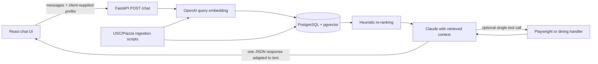

# TrojanClaw Project Review

_Repository review performed on 2026-10-04. This document describes the code currently present in this repository, not only the intended product described in the planning documents._

## 1. Executive summary

TrojanClaw is a hackathon-stage USC assistant with a polished React chat interface, a FastAPI orchestration endpoint, a PostgreSQL/pgvector retrieval pipeline, Claude tool calling, and ingestion scripts for public USC pages and Piazza data.

The strongest implemented path is:

1. Collect a basic student profile in the browser.
2. Send the chat history and profile to `POST /chat`.
3. Embed the latest message with OpenAI.
4. Retrieve and heuristically re-rank USC/Piazza chunks from PostgreSQL.
5. Give those chunks and the conversation to Claude.
6. Optionally execute one of four Playwright/dining tools.
7. Render Claude's Markdown response in the React UI.

The project is a credible prototype, but it is not production-ready and several README claims do not match the implementation. The most important gaps are:

- Authentication is simulated entirely in `localStorage`; neither USC SSO nor backend authorization exists.
- A caller can supply any `course_id`, creating a serious risk of cross-course Piazza data exposure.
- The “booking” tool does not book a room, collect a time/capacity, or write a booking to the database.
- The “live” dining menus are hard-coded sample text.
- Attachments are displayed by filename but never uploaded or processed.
- Deadlines are static embedded text, not a user-scoped deadline manager.
- The system prompt suppresses citations even though the README promises every answer is cited.
- Retrieved text is called “absolute fact,” with no similarity cutoff or freshness enforcement, increasing hallucination and stale-answer risk.
- There is almost no automated test coverage, no CI, no deployment configuration, and limited operational safeguards.

The recommended first milestone is not adding more surface-area features. It is making identity, authorization, grounding, citations, and action confirmation trustworthy. After that, the best product additions are real syllabus/LMS deadline ingestion, live room availability and booking handoff, live dining data, calendar integration, and proactive personalized digests.

## 2. What is in the repository

### Frontend

- React 19 + TypeScript + Vite application in `frontend/`.
- One large page component in `frontend/src/App.tsx`.
- USC-styled responsive chat UI in `frontend/src/App.css`.
- AI SDK `useChat` state management with a custom JSON-to-text fetch adapter.
- Markdown/GFM rendering through `react-markdown` and `remark-gfm`.
- Local profile onboarding, task chips, file picker, authentication prompts, regenerate, stop, and loading/error states.

### Backend

- FastAPI application in `backend/app/main.py`.
- A single main product endpoint, `POST /chat`, in `backend/app/routers/chat.py`.
- OpenAI query embedding in `backend/app/rag/embed.py`.
- PostgreSQL/pgvector retrieval and heuristic re-ranking in `backend/app/rag/retrieve.py`.
- Claude system-prompt construction in `backend/app/rag/prompt.py`.
- Four Claude tool definitions and Playwright/hard-coded handlers.
- Public USC page, dining, deadline, and Piazza ingestion scripts.
- Schema creation for `documents` and `piazza_data` tables.

### Documentation and assets

- Root README describing the hackathon product and intended feature set.
- Backend setup README, an implementation plan, and a much broader product context document.
- Four large generated frontend logo images and one cover image.
- One manual browser-booking script named `test_booking.py`; it is not an automated test.

## 3. How the system works

### 3.1 High-level architecture

### 3.2 Frontend lifecycle

1. The app always opens a profile modal.
2. The user must select “new” or “existing,” select a USC school, and enter at least one comma-separated course.
3. The app builds `user_context` containing student type, school, all courses, and the first course as `course_id`.
4. Prompting is disabled until “authentication” is complete.
5. Clicking Authenticate opens `https://my.usc.edu` in another tab. The user then clicks “I have authenticated.”
6. That confirmation writes `usc-shibboleth-authenticated=true` to browser `localStorage`; no token or callback is received.
7. `useChat` sends the full non-empty conversation plus `user_context` to the backend.
8. The custom fetch adapter waits for a complete JSON `{ response }` and converts it to a text response for the AI SDK.
9. Assistant content is rendered as Markdown; user content is rendered as plain text.

The one-click task buttons only populate the prompt box. They do not start the request automatically. The file picker stores and displays selected filenames only.

### 3.3 Chat/RAG lifecycle

1. FastAPI accepts a list of messages and an untyped context dictionary.
2. It treats the final message content as the current query.
3. OpenAI `text-embedding-3-small` creates a 1,536-dimension vector.
4. The backend infers likely data types from keyword lists such as `library`, `health`, `deadline`, and `dining`.
5. For course-like queries, it separately searches `piazza_course` documents and may fall back to `ILIKE` over raw `piazza_data`.
6. It also searches general documents by cosine distance.
7. Candidate scores combine negative vector distance, title/body keyword hits, type bonus, Piazza bonus, and course bonus.
8. Results are sorted and normally limited to two chunks per source. Dining and deadline documents bypass the per-source cap.
9. Up to six chunks are inserted into the Claude system prompt alongside the student profile.
10. Claude returns text or requests a tool.
11. At most one recognized tool call is executed, its result is sent back to Claude, and the first response content block is returned.

### 3.4 Piazza synchronization

- The course is taken from explicit `course_id`, otherwise the first enrolled/legacy course.
- A course-like query with fewer than two matching Piazza chunks triggers a synchronous refresh attempt.
- The refresh cooldown is held in an in-process dictionary: 15 minutes normally, 2 minutes when forced.
- Piazza sources are tried in this order:
  1. `piazza-api` using email, password, and network ID environment variables.
  2. Every JSON file under the configured export directory.
  3. Optional configured Piazza thread URLs fetched with an optional cookie.
- Raw posts replace all `piazza_data` rows for the course.
- Existing vector chunks for the course are deleted, then newly chunked posts are embedded and inserted.

### 3.5 Public USC ingestion

- Fourteen configured URLs cover schedules, orientation, maps, libraries, student services, and health.
- `httpx` downloads static HTML.
- BeautifulSoup removes scripts, styles, headers, footers, navigation, and collapses visible text.
- Text is split into approximately 400-word chunks with 50-word overlap.
- Source metadata is prepended to every chunk before embedding.
- Each chunk is embedded serially and upserted by `(source_url, chunk_index)`.

This pipeline is manual. There is no scheduler, crawl manifest, freshness alert, or JavaScript rendering.

### 3.6 Claude tools

#### `book_study_room`

- Inputs: library name and date only.
- Connects to an already-running local Chrome instance on port `9222`.
- Opens USC LibCal, best-effort clicks a location and date, then stops before time selection or submission.
- If exact date selection fails, it clicks “next day” once regardless of the requested date.
- It never reserves a room and never stores a booking.

#### `open_dining_menu`

- Searches Google for the restaurant menu in the attached Chrome session.
- Opens the first search result if it can find one.

#### `fetch_live_dining_menu`

- Returns hard-coded sample menus for EVK, Village, or Parkside.
- Despite its name and response label, it makes no live network/API request.

#### `browser_google_search`

- Opens a Google results tab for a model-supplied query in the attached Chrome session.

## 4. What is genuinely implemented versus only claimed or partial

### Implemented

- A visually complete single-page chat experience.
- Student-profile context passed to the model.
- Multi-turn chat history.
- OpenAI embeddings and pgvector retrieval.
- Data-type inference, keyword re-ranking, and source diversity.
- Public USC HTML ingestion.
- Multiple Piazza ingestion routes and course-filtered vector search.
- Claude tool calling and a second model pass with tool results.
- Best-effort browser navigation for LibCal and Google.
- Markdown rendering, stop/regenerate controls, responsive styling, and frontend loading states.

### Partial or prototype-only

- Authentication: visual/client-side confirmation only.
- Room booking: navigation assistance only, not booking.
- Dining: manually seeded locations and hard-coded “live” menus.
- Piazza: potentially live if credentials/network mappings work, but refreshed during a chat request and not securely user-scoped.
- Deadlines: four fixed 2026 examples embedded as documents; no CRUD, ownership, feed, or notifications.
- File upload: filename display only.
- Streaming: the UI uses a text-stream interface, but the backend returns one complete JSON response.
- Personalization: prompt context only; no trusted identity, enrollment lookup, residence/campus/commuter context, or durable profile.

### Described but absent

- Real USC NetID/Shibboleth integration.
- Source citation chips or cited answers.
- Booking and deadline database models/endpoints.
- Booking confirmation modal and cancellation.
- Health/advising appointment actions.
- Syllabus PDF parsing and deadline extraction.
- Deadline tracker UI.
- Live availability search by time and capacity.
- Automated data refresh.
- Campus map integration beyond RAG text.
- Notifications/calendar sync.
- Mobile/native application.

## 5. Strengths worth preserving

1. **Clear prototype scope.** The repository is small enough to understand and iterate quickly.
2. **End-to-end RAG path exists.** Ingestion, embeddings, retrieval, prompt assembly, model generation, and rendering are all represented.
3. **Metadata-aware retrieval.** Data types, course identifiers, title/body keyword hits, and source diversity are useful improvements over plain nearest-neighbor search.
4. **Piazza fallbacks are pragmatic.** API, export, URL scrape, vector search, and raw text search provide multiple recovery paths.
5. **The UI has solid baseline polish.** Loading, stop, regenerate, onboarding, responsive layout, Markdown, and accessible labels are present.
6. **Public-page ingestion is idempotent for stable chunk indices.** A unique `(source_url, chunk_index)` index and upsert prevent the most obvious duplicate growth for the main scraper.
7. **Secrets are environment-driven.** No API keys were found committed in tracked source.
8. **Frontend health is good.** `npm run lint` and `npm run build` both pass.

## 6. Flaws and risks

Severity meanings:

- **Critical:** unsafe to expose to real students or private course data.
- **High:** core behavior is misleading, incorrect, or unreliable.
- **Medium:** significant maintainability, quality, accessibility, or operational weakness.
- **Low:** cleanup or optimization that should follow the core fixes.

### 6.1 Critical security and privacy issues

#### C1. Authentication is not authentication

Evidence: `frontend/src/App.tsx` sets authentication after the user clicks a confirmation button and stores a boolean in `localStorage`. The backend has no authentication middleware and does not validate the `authenticated` context field.

Impact: anyone can set the flag, call `/chat` directly, consume paid API resources, and claim any profile/course.

Fix: implement a backend-verified OIDC/SAML/Shibboleth flow, issue a secure session, and derive identity/profile server-side. Treat all frontend context as untrusted.

#### C2. Course data authorization can be bypassed

Evidence: retrieval filters Piazza rows using `user_context.course_id`, which is supplied entirely by the browser. No membership check is performed.

Impact: a caller who guesses or learns another course identifier may retrieve private Piazza content. If student-specific data is added later, this becomes a direct FERPA/privacy exposure.

Fix: map the authenticated user to authorized course IDs on the server; use tenant/course row-level security; reject unauthorized course selection; audit access.

#### C3. Retrieved and scraped text is vulnerable to prompt injection

Evidence: arbitrary webpage/Piazza text is pasted directly into the system prompt, followed by an instruction to treat it as “ABSOLUTE FACT.” There is no content boundary, instruction filtering, or tool policy separate from the model prompt.

Impact: malicious or accidental instructions in a page or Piazza post can influence the assistant and possibly trigger browser tools.

Fix: treat retrieved text as untrusted quoted data, explicitly forbid following instructions in it, keep tool authorization in code, add prompt-injection screening, and require confirmation for actions.

#### C4. No abuse controls around paid and stateful operations

Evidence: `/chat` has no authentication, authorization, rate limit, request-size limit, per-user budget, or concurrency limit. Each request can call OpenAI, PostgreSQL, Claude twice, Piazza, and Playwright.

Impact: denial of service, unexpected API cost, browser contention, and credential/account lockout.

Fix: authenticated quotas, message/context size limits, timeouts, circuit breakers, queueing, caching, and per-user/tool rate limits.

#### C5. Server-controlled Chrome is an unsafe shared action surface

Evidence: Playwright attaches to the first browser context of a Chrome instance exposed on `127.0.0.1:9222`, then acts using that context's sessions.

Impact: concurrent users can interfere with one another; the service may expose or act through a privileged logged-in browser; this design does not work safely in a multi-user deployment.

Fix: do not automate a shared personal browser from the server. Prefer official APIs or a user-side extension. If browser automation is unavoidable, isolate ephemeral browser contexts per user/job and restrict destinations.

### 6.2 High-severity product correctness issues

#### H1. Product claims conflict with actual behavior

The README claims real booking writes, booking UI reflection, source citations, live dining, deadline management, and a Claude Sonnet model. The code navigates only, suppresses citations, uses static dining/deadline data, has no bookings/deadlines models, and calls `claude-haiku-4-5-20251001`.

Impact: users and maintainers cannot tell what is trustworthy; demos can misrepresent actions as completed.

Fix: update copy immediately and label prototype/mock behavior. Only restore claims after acceptance tests prove them.

#### H2. The prompt encourages overconfidence and suppresses citations

Evidence: `backend/app/rag/prompt.py` says retrieved data is absolute fact, instructs the model to answer authoritatively, forbids mentioning missing visibility in some cases, and explicitly says not to include sources.

Impact: stale, weak, or irrelevant retrieval can become a confident false answer. Users cannot verify high-impact academic, health, or immigration guidance.

Fix: require inline citations, calibrated uncertainty, freshness display, and “I could not verify” behavior below a confidence threshold.

#### H3. There is no retrieval similarity threshold

Evidence: the README says a minimum similarity threshold was added, but `retrieve_context` always re-ranks the nearest candidates and returns up to `top_k`, regardless of distance.

Impact: unrelated documents are presented to Claude as facts even for out-of-domain queries.

Fix: tune and enforce thresholds on an evaluation set; return no evidence when nothing qualifies; expose confidence/source metadata.

#### H4. Room booking is incomplete and can report misleading success

Evidence: the tool schema has no time, duration, capacity, room, or confirmation fields. The handler catches click failures, may click only “next day,” then returns a success message without reserving anything.

Impact: a student may believe a room was booked or the intended date was selected when neither is true.

Fix: rename it to `open_room_search` now. For real booking, search actual availability, collect required fields, show a confirmation step, complete the transaction, return a reservation ID, and verify it.

#### H5. “Live” dining responses are fabricated static menus

Evidence: `execute_fetch_live_dining_menu` contains hard-coded dishes and calls them `LIVE MENU`.

Impact: students can receive false dietary or availability information.

Fix: integrate an official/current source, include retrieval timestamp, dietary/allergen caveats, and fail honestly when unavailable.

#### H6. Deadline data is static, global, and stale-prone

Evidence: `push_deadlines.py` embeds four hard-coded assignments. It has no student ID, deadline table, update/delete flow, or ownership. Re-running inserts duplicates because `chunk_index` is null and the unique index does not cover nulls as equal.

Impact: incorrect personal guidance, duplicated results, and no usable deadline-management product.

Fix: create normalized user/course/deadline tables; support syllabus/LMS/calendar import; preserve source and confidence; use embeddings only for discovery, not as the system of record.

#### H7. Piazza refresh can destroy the last good vector corpus

Evidence: sync replaces raw posts, deletes existing course documents, commits that deletion, and only then embeds/inserts replacements. If any embedding or insert fails, rollback cannot restore the already-committed old documents.

Impact: a transient OpenAI/database failure can leave a course with no vector documents.

Fix: stage a complete new version, validate counts, then atomically switch versions in one transaction. Never delete the last known-good corpus before replacement succeeds.

#### H8. Local Piazza exports are not course-scoped

Evidence: every JSON file under one export directory is loaded and assigned to whichever `course_id` is currently being synchronized.

Impact: posts can be mislabeled, leaked across courses, and returned to the wrong students.

Fix: require course-specific directories/manifests and verify each export's course/network ID before ingestion.

#### H9. Tool-response handling is brittle

Evidence: the router executes only the first tool-use block, permits only one tool round, and assumes `response.content[0].text` exists after the final call.

Impact: valid multi-tool/model responses can crash, ignore actions, or return the wrong block.

Fix: implement a bounded tool loop; handle every content block by type; validate tool inputs with typed models; return a structured result.

#### H10. Attachments are a non-functional UI affordance

Evidence: the frontend records only selected filenames; no file bytes or metadata are sent.

Impact: users reasonably expect syllabus upload to work but the model never sees the file.

Fix: hide the control until implemented, or add secure upload, scanning, parsing, progress, retention/deletion, and explicit confirmation of extracted deadlines.

#### H11. The first enrolled course silently controls course retrieval

Evidence: the frontend sets `course_id` to `enrolledCourses[0]`; backend fallback logic does the same.

Impact: questions about a second or third course may search/sync the first course, producing wrong answers and contaminating context.

Fix: identify course from the query against an authorized course list, ask when ambiguous, and allow explicit course selection.

#### H12. Raw internal exceptions are exposed to clients

Evidence: the `/chat` catch-all returns `HTTPException(..., detail=str(e))`.

Impact: database/SDK details and configuration state may leak, while every failure is incorrectly reported as HTTP 500.

Fix: log a correlation ID and structured exception internally; return stable public error codes/messages; preserve expected 4xx errors.

### 6.3 Medium-severity engineering and operations issues

#### M1. Backend setup is currently incomplete

- `requirements.txt` omits `psycopg2`/`psycopg2-binary`, although multiple imported modules require it.
- `playwright` is unpinned and browser installation is undocumented.
- Backend README tells users to copy `backend/.env.example`, but that file does not exist.
- README describes `SUPABASE_URL` as an HTTPS project URL, while retrieval and ingestion require a PostgreSQL connection string.
- `supabase_client.py` expects HTTPS-style URL/key configuration but is unused by the active data path.
- `backend/package-lock.json` is empty/unrelated and adds confusion.

Fix: choose one database configuration model, add a real env template, lock dependencies, add install verification, and remove dead setup artifacts.

#### M2. No automated test suite

The only test-named file manually launches Playwright and prints output. There are no unit, API, retrieval, prompt, security, frontend component, end-to-end, or ingestion tests.

Fix: add pytest and frontend tests; mock external services; build a RAG evaluation set; add contract tests for every tool and authentication/authorization boundary.

#### M3. No CI/CD or reproducible deployment

There are no workflow files, container definitions, infrastructure manifests, migrations, or production server configuration.

Fix: add CI for lint, type-check, tests, dependency audit, build, and migration validation; add reproducible deploy configs and separate dev/staging/prod environments.

#### M4. Database connections and retrieval failures are fragile

- A new PostgreSQL connection is created for every retrieval; there is no pool or connect/query timeout.
- Retrieval catches database/query errors, prints them, and returns an empty list, disguising outages as “no context.”
- Schema DDL can be run from ingestion paths that may also be triggered during a chat request.

Fix: use a connection pool, explicit timeouts/retries, migrations outside request handling, and distinguish “no matches” from “retrieval unavailable.”

#### M5. Ingestion is slow, expensive, and not atomic

- Embeddings are requested one chunk at a time.
- The main scraper commits after every chunk.
- There is no retry/backoff, batch API use, content hash, unchanged-content skip, cost estimate, or resumable job state.
- When a source becomes shorter, obsolete high-index chunks remain because the scraper never removes them.

Fix: hash cleaned content, batch embeddings/inserts, retry safely, version each crawl, delete stale chunks only after successful replacement, and record job metrics.

#### M6. Static HTML scraping cannot cover several configured sources reliably

Interactive/JavaScript-rendered pages such as maps or schedules may yield little useful text. The scraper does not use sitemaps/APIs, structured data, per-site parsers, crawl delays, conditional requests, or quality checks.

Fix: use official feeds/APIs where possible; create source-specific adapters and validation; monitor fetch status, extracted length, and freshness.

#### M7. Keyword routing is simplistic and error-prone

Substring lists can misclassify intent, mix types, and overlook vocabulary. “Course/class” maps to schedule even when the user asks about a Piazza assignment. Dining/deadline source caps are disabled, which can reduce diversity.

Fix: use a tested intent classifier or hybrid filters, structured metadata, date/course extraction, and evaluation-based weights.

#### M8. Freshness is stored but not used

`last_scraped` is written but retrieval does not filter, penalize, or display stale content. Static dining hours and deadlines can remain indefinitely.

Fix: define per-source freshness SLAs, add recency scoring/expiry, and show “updated at” to users.

#### M9. Piazza cooldown does not work across processes

The cooldown dictionary is process-local and disappears on restart. Multiple workers can synchronize the same course concurrently.

Fix: use a database/Redis distributed lock and persisted next-refresh time; move synchronization to background jobs.

#### M10. Chat request validation is too weak

`role` is any string; `user_context` is an arbitrary dictionary; message counts and lengths are unlimited; the final item is assumed to be the user's query.

Fix: define strict Pydantic models/enums, enforce alternating roles and final user message, cap sizes, normalize course codes, and reject unexpected context keys.

#### M11. The API is not actually streaming

The backend waits for embedding, retrieval, optional Piazza sync, Claude, optional Playwright, and possibly a second Claude call before returning JSON. The frontend adapter merely converts that completed JSON into text.

Impact: slow perceived performance; pressing Stop can cancel the browser fetch while paid server work may continue.

Fix: use SSE/chunked streaming, cancellable jobs, staged status events, and background sync rather than Piazza ingestion inside chat latency.

#### M12. Error handling in `sendChatMessage` discards server detail

The function throws the parsed detail inside a `try`, then immediately catches its own throw and replaces it with a generic status message. It is currently unused but will mislead future callers.

Fix: parse in the `try`, throw after it, and share one well-tested API client rather than two request paths.

#### M13. CORS configuration is unsuitable for production

`allow_origins=["*"]` is paired with credentials and all methods/headers.

Fix: configure exact frontend origins per environment and only necessary methods/headers. Add CSRF protections if cookie sessions are used.

#### M14. Prompt/context size and cost are uncontrolled

The full conversation is resent on every request, up to six large chunks are appended, and there is no token counting, history summarization, cache, or cost telemetry.

Fix: enforce token budgets, summarize old turns, cache embeddings/results, and record model/token cost per request.

#### M15. Healthcheck is shallow

`/healthcheck` always returns `ok` without testing database/schema or required configuration.

Fix: separate liveness from readiness; readiness should check configuration and critical dependencies without performing paid calls.

#### M16. Observability is limited to `print`

There are no structured logs, request IDs, metrics, traces, dashboards, audit logs, ingestion reports, or model/tool outcome telemetry.

Fix: add privacy-aware structured logging, latency/error/cost/retrieval metrics, distributed tracing, and action audit trails.

#### M17. Accessibility and modal behavior need work

The app has useful labels and ARIA attributes, but modals do not trap focus, restore focus, or close with Escape. The authentication toast is not an announced live region. Motion has no reduced-motion override.

Fix: use an accessible dialog implementation, add keyboard/focus tests, live status semantics, visible focus styles, and `prefers-reduced-motion` behavior.

#### M18. Profile and chat state are fragile

Only the fake auth flag persists. Refreshing loses the profile and conversation; there is no logout, session expiry, conversation management, deletion, or privacy control.

Fix: add real sessions, explicit logout, opt-in persistence, history naming/search/delete, and retention settings.

#### M19. External Google fonts and first-result browsing add privacy/reliability concerns

The CSS loads fonts from Google, and a tool opens Google's first result rather than a verified URL.

Fix: self-host fonts or use system fonts; maintain verified domain allowlists and show links instead of automatically navigating to untrusted first results.

### 6.4 Low-severity maintainability and polish issues

1. `App.tsx` and `App.css` are large monoliths; split profile/auth/chat/composer/task components and domain hooks.
2. The random logo changes across page loads and four public images total about 6.3 MB; select one optimized WebP/AVIF asset and use responsive sizes.
3. `quickActions` is deliberately empty while its prompt map and rendering code remain.
4. `retrieve.py` imports `re` twice.
5. Product naming alternates among TrojanClaw, TrojanAI, and “USC AI Concierge.”
6. Model names and behavior are hard-coded instead of centralized in typed settings.
7. Similar embedding helpers are duplicated across ingestion scripts.
8. SQL and schema logic are embedded in scripts rather than versioned migrations/repositories.
9. `push_dining.py` and `push_deadlines.py` use plain inserts, so repeated runs grow duplicates.
10. `_extract_text` computes extraction twice for list items, adding unnecessary work.
11. The root README and backend project structure are out of date; the frontend README is still the Vite template.
12. There is no license, contribution guide, architecture decision record, or documented data-retention policy.

## 7. Suggested feature additions

These are ordered by product value and prerequisite safety, not novelty.

### Phase 0: Make the prototype trustworthy

1. **Real USC identity and authorization**
   - OIDC/SAML/Shibboleth callback handled by the backend.
   - Secure HTTP-only session cookies.
   - Server-derived school, enrollment, roles, and authorized course IDs.
   - Logout, expiry, audit logs, and data-deletion controls.

2. **Cited, confidence-aware answers**
   - Inline source links next to factual claims.
   - Source title, official-domain badge, retrieved/updated time, and confidence.
   - Honest no-evidence behavior and clear distinction between official facts and assistant suggestions.

3. **Safe action confirmation framework**
   - Structured preview of every proposed action.
   - Explicit user confirmation before booking, calendar write, or message submission.
   - Idempotency keys, audit trail, success receipt, and rollback/cancel where possible.

4. **Grounding evaluation suite**
   - Curated USC questions with expected sources and facts.
   - Retrieval recall/precision, citation correctness, freshness, refusal, prompt-injection, and cross-course leakage tests.

### Phase 1: Complete the promised core product

1. **Syllabus and LMS deadline ingestion**
   - PDF/DOCX upload with malware scanning and OCR fallback.
   - Structured extraction of course, item, due time, timezone, weighting, and source page.
   - Review screen before saving.
   - Canvas/Blackboard integration if authorized and available.
   - Duplicate detection and change alerts.

2. **Unified deadline planner**
   - User-scoped deadline CRUD.
   - Week/month/agenda views.
   - Priority and estimated-effort planning.
   - Google/Apple/Outlook calendar export or sync.
   - Configurable reminders and quiet hours.

3. **Real study-room discovery and booking handoff**
   - Search by date, time, duration, capacity, equipment, accessibility, and library.
   - Live availability with timestamp.
   - Deep link or supported booking API.
   - Reservation confirmation and “My bookings” view.

4. **Live dining and dietary support**
   - Official daily menus and hours.
   - Meal period, open-now, distance, meal-plan eligibility, allergens, vegan/vegetarian/halal filters.
   - Prominent warning that students with allergies must verify with USC Dining.

5. **Course activity digest**
   - Per-course Piazza summary of announcements, unresolved questions, instructor answers, and due-date changes.
   - Read/unread state and source links.
   - Scheduled daily/weekly digest without refreshing inside chat requests.

### Phase 2: Improve daily usefulness

1. **Morning/weekly student briefing** combining deadlines, classes, bookings, dining, transit, campus closures, and relevant announcements.
2. **Campus navigation** with building aliases, accessible routes, walking time, shuttle stops, and indoor room hints.
3. **Live shuttle/transit status** with arrival predictions and disruption alerts.
4. **Personal resource navigator** for health, mental health, financial aid, international services, disability services, tutoring, and crisis help—with official links and escalation rules.
5. **Course registration assistant** that explains prerequisites, detects schedule conflicts, links official sections, and never claims enrollment without confirmation.
6. **Conversation and artifact workspace** with saved plans, deadlines, sources, bookings, and export.
7. **Feedback controls** for wrong answer, stale source, bad citation, and unsuccessful action, feeding an admin review queue.
8. **Progressive web app** with installability, push notifications, offline access to saved plans, and responsive small-screen navigation.

### Phase 3: Platform and operations

1. **Admin ingestion console** showing source health, last crawl, extracted chunks, failures, freshness SLA, and re-index controls.
2. **Source registry and policy engine** defining authority, refresh frequency, allowed uses, privacy class, and retention.
3. **Model and retrieval observability** for latency, cost, tool success, citation coverage, empty retrieval, and user feedback.
4. **Versioned knowledge base** with atomic publishing and rollback.
5. **Feature flags and staged rollout** for high-risk integrations.
6. **Multi-campus/multi-school expansion** through configuration rather than hard-coded keyword lists.
7. **Human escalation** to the correct official office when risk or uncertainty is high.

## 8. Recommended implementation roadmap

### Milestone 1: Secure foundation

- Replace fake auth with a real backend session.
- Add user, course-membership, document-scope, and audit models.
- Restrict CORS and protect `/chat`.
- Add rate/size/token limits and stable public errors.
- Remove or relabel fake live/booking behavior.
- Add backend dependency lock, env template, migrations, CI, and baseline tests.

Exit criterion: an unauthenticated or unauthorized user cannot access chat or any course data, and security tests prove course isolation.

### Milestone 2: Trustworthy answers

- Version and atomically publish ingestion runs.
- Add freshness policies and similarity thresholds.
- Rework prompts to treat context as evidence, not instructions.
- Return structured citations and render citation chips.
- Build and gate releases on a USC RAG evaluation set.

Exit criterion: answers either cite qualifying official evidence or clearly say they could not verify the answer.

### Milestone 3: Complete one end-to-end action

Choose study rooms or deadlines, not both initially.

For rooms: implement real availability, confirmation, supported handoff/API, receipt, and cancellation/status.

For deadlines: implement secure upload, reviewed extraction, normalized storage, planner UI, and calendar export.

Exit criterion: the user can complete and later verify the action without relying on model prose as proof.

### Milestone 4: Fresh campus intelligence

- Move Piazza and public-site sync to background jobs.
- Add live dining, hours, transit, and closure sources.
- Add proactive digests and notifications.
- Add admin source-health tooling and observability.

Exit criterion: every time-sensitive answer shows its freshness, and missed refreshes alert maintainers before users report them.

## 9. Validation performed during this review

### Passed

- `npm run lint`
- `npm run build`
- Python syntax compilation with `python3 -m compileall -q app`
- Git worktree was clean before this report was added.

### Not fully runnable in the current environment

- The backend import failed because Python runtime dependencies are not installed in the active environment.
- External OpenAI, Anthropic, PostgreSQL/Supabase, Piazza, USC, and browser automation flows were not executed because they require credentials, network access, data, and/or an attached Chrome instance.
- Static inspection additionally confirmed that `psycopg2` is used but absent from `backend/requirements.txt`.

### Test coverage found

- No automated backend tests.
- No frontend unit/component/end-to-end tests.
- `backend/test_booking.py` is a manual demonstration script, not a test with assertions.

## 10. Bottom line

TrojanClaw has a useful prototype skeleton and a good product direction. Its current value lies in the UI, RAG plumbing, and evidence that several campus workflows can be unified conversationally. Its largest weakness is not missing feature count; it is the gap between what the interface/README says happened and what the code can prove happened.

The project should next optimize for **trust**: real identity, strict course isolation, cited and freshness-aware answers, honest tool status, confirmed actions, and repeatable tests. Once that foundation exists, the deadline planner and room-booking flow are the two strongest additions because they turn the assistant from a campus search box into a dependable daily student tool.
