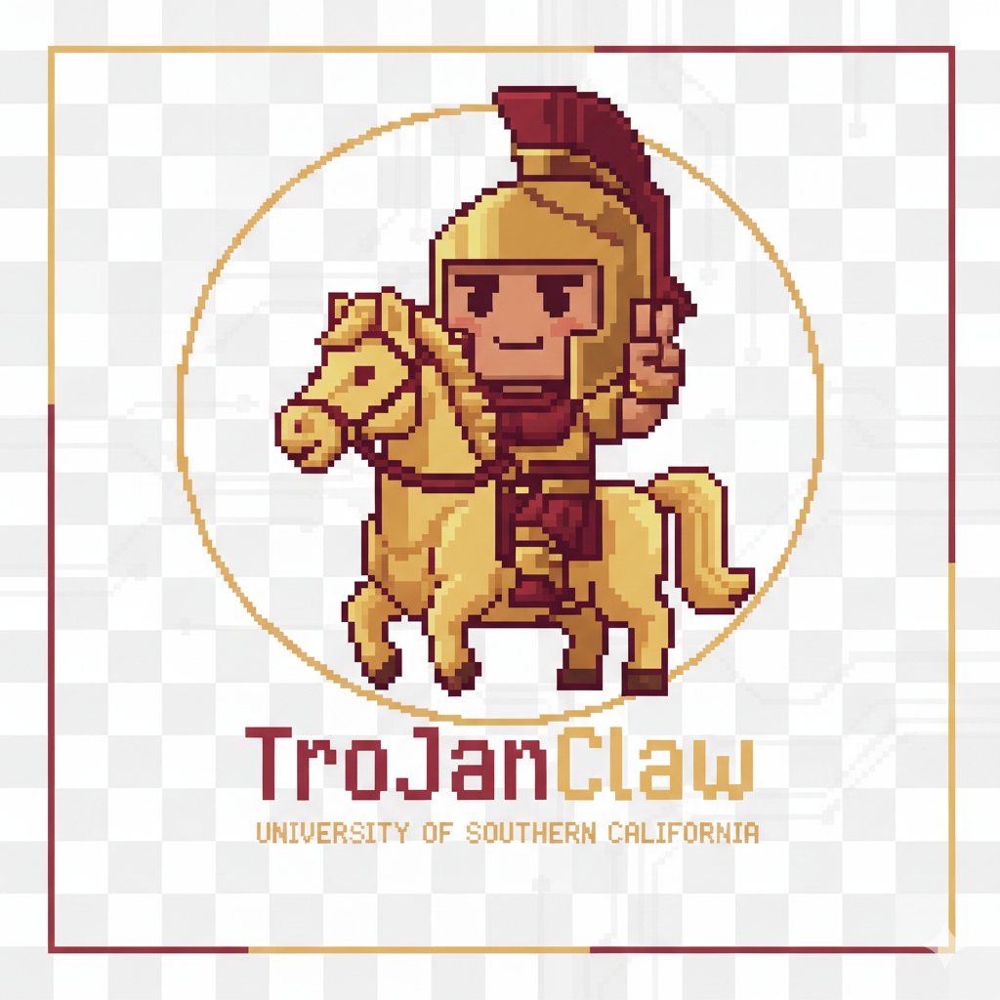
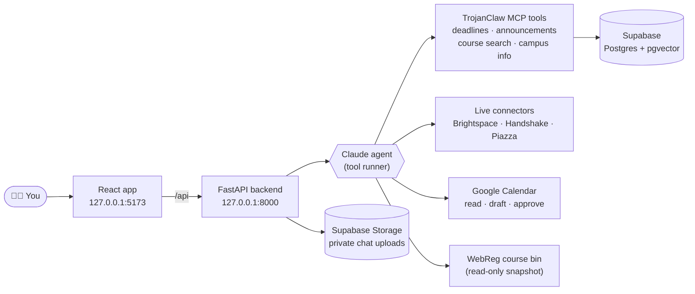

<div align="center">



# TrojanClaw

**Your USC semester, in one chat.**

One USC login connects Brightspace, Handshake, Piazza, WebReg and Google Calendar.<br>
Then just ask: *what's due, what's next, what fits your week.*


[Features](#-features) · [How it works](#-how-it-works) · [Quick start](#-quick-start) · [Configuration](#-configuration) · [Project map](#-project-map) · [Docs](#-docs)

</div>

---

## ✨ Features

| | |
| :--- | :--- |
| 🔐 **One sign-in** | **Continue with Google** with your @usc.edu account, then one USC login (NetID + Duo) in a private remote browser. TrojanClaw connects Google Calendar, Brightspace, Handshake and your WebReg course bin. |
| 💬 **Chat that checks for you** | Replies stream in word by word, with a live status line ("Checking Brightspace: upcoming due dates") and the sources each answer used. |
| 🃏 **Answers as cards** | Jobs, events, deadlines, courses and posts come back as tidy cards with an **Open** button to the real page in Handshake, Brightspace, Piazza or EngageSC. Every link comes from a tool result, never made up. |
| 🗂️ **Saved chats** | Every chat has its own link, an AI-written title, and can be searched, pinned, renamed or deleted. |
| 🔌 **Sources you control** | Flip Brightspace, Handshake, Piazza and campus events on or off with one switch in the chat box. If a session expires, a banner offers **Reconnect**. |
| 📅 **Google Calendar** | Ask what's on your calendar, or have chat draft an event, a repeating series or a change. Nothing is saved until you press **Approve**. |
| 🎓 **Next term's classes** | Your WebReg course bin (planned and registered sections) is read during sign-in, so you can ask about next term. Read-only: it never registers or drops. |
| 📎 **Files and 🎤 voice** | Attach PDFs, images, notes, Word, PowerPoint or Excel (5 per message, 5 MB each), or dictate your question. |
| 🌗 **Made for students** | Light and dark themes, keyboard shortcuts (⌘K new chat, ⌘/ type, ⌘⇧F search), a resizable sidebar, and a phone-friendly layout. |

> [!NOTE]
> Every source is **read-only**. TrojanClaw never submits work, applies to jobs, registers for classes or changes your calendar without your click.

---

## 🧭 How it works



1. **You ask** in the chat. The browser sends only your new message (and any files).
2. **The agent decides** which tools it needs: your synced course data, a live connector, your calendar, WebReg, or public USC information.
3. **The reply streams back** with what it checked, lists shown as linked cards, and where each fact came from. Your chat is saved for next time.

Connector logins run in private Browserbase Chromium sessions, and each TrojanClaw account keeps its own encrypted sessions.

> [!TIP]
> The agent runs on **Claude Sonnet 5.5** at low effort, with prompt caching so earlier turns are re-read at the cache price. Change the model, effort or tool rounds in [`config/agent.yaml`](config/agent.yaml); `claude-haiku-5-5` is cheaper still.

---

## 🚀 Quick start

### What you need

| Tool | Version | Used for |
| :--- | :--- | :--- |
| [Python](https://www.python.org/downloads/) | 3.11 | Backend |
| [uv](https://docs.astral.sh/uv/getting-started/installation/) | latest | Connector helpers (installs Python 3.12 for them) |
| [Node.js](https://nodejs.org/) | 22.12+ | Frontend and Google Calendar |
| Browserbase project | persistent contexts | Private managed Chromium for USC and connector sign-in |

### 1 · Set up the backend

<details open>
<summary><b>macOS</b></summary>

```sh
cd backend
python3.11 -m venv .venv
source .venv/bin/activate
pip install -r requirements-dev.txt
cp .env.example .env
```

</details>

<details>
<summary><b>Windows (PowerShell)</b></summary>

```powershell
cd backend
py -3.11 -m venv .venv
.venv\Scripts\Activate.ps1
pip install -r requirements-dev.txt
Copy-Item .env.example .env
```

</details>

Then fill in `backend/.env` (see [Configuration](#-configuration)) and apply every file in `supabase/migrations/`, in order, to your Supabase project.

### 2 · Install the connectors (once, from the repository root)

```sh
uv sync --locked --project integrations/handshake
uv sync --locked --project integrations/piazza --python 3.12
npm ci --prefix integrations/brightspace
npm ci --prefix integrations/google-calendar
```

### 3 · Run it (two terminals)

```sh
# Terminal 1: backend/ (virtual environment active)
uvicorn app.main:app --reload --host 127.0.0.1 --port 8000
```

```sh
# Terminal 2: frontend/  (first time: copy .env.example to .env, then npm install)
npm run dev
```

Open **http://127.0.0.1:5173**, click **Get started**, then **Continue with Google**. 🎉

USC and connector logins open in an embedded Browserbase browser. Set
`CONNECTOR_MODE=browserbase`, `BROWSERBASE_API_KEY`, `BROWSERBASE_PROJECT_ID`, and
`CONNECTOR_ENCRYPTION_KEYS` in `backend/.env`. See [the connector guide](CONNECTORS.md)
for encrypted storage, migrations, and desktop development mode.

> [!IMPORTANT]
> Always use **`127.0.0.1`**, not `localhost`. The browser keeps sign-in cookies per host, and mixing the two breaks sign-in.

---

## ⚙️ Configuration

All settings live in `backend/.env` (template: [`backend/.env.example`](backend/.env.example)). The agent's model, effort and tools are in [`config/agent.yaml`](config/agent.yaml); its instructions are in [`prompts/ai_instructions.md`](prompts/ai_instructions.md).

| Setting | What it's for | Required |
| :--- | :--- | :---: |
| `DATABASE_URL` | Supabase Postgres (Session pooler connection string) | ✅ |
| `SUPABASE_URL`, `SUPABASE_KEY` | Supabase project URL and publishable key | ✅ |
| `SUPABASE_SECRET_KEY` | Secret key for the private file-upload bucket (backend only) | for 📎 |
| `ANTHROPIC_API_KEY` | Claude | ✅ |
| `GEMINI_API_KEY` | Embeddings for course and campus search | ✅ |
| `GOOGLE_CALENDAR_*` | Google OAuth client (sign-in and Calendar), redirect URIs and the token encryption key | ✅ |
| `CORS_ORIGINS` | Allowed frontend address (`http://127.0.0.1:5173`) | ✅ |

The frontend needs only `frontend/.env` with `VITE_API_BASE_URL=/api`. Vite forwards `/api` to the backend.

---

## 🗺️ Project map

```text
TrojanClaw_v2/
├── backend/                 FastAPI app
│   ├── app/agent/           Claude agent runtime (streaming, tool activity)
│   ├── app/mcp_server/      TrojanClaw MCP tools, built per student
│   ├── app/integrations/    Live connectors, WebReg, Google Calendar gateway
│   ├── app/services/        Chat, calendar, uploads, sign-in (Google, then USC)
│   ├── app/api/routes/      HTTP endpoints
│   └── tests/               Backend tests
├── frontend/                React 19 + Vite + Tailwind (USC cardinal & gold)
│   └── src/                 Screens, chat, answer cards, Sources, Settings
├── integrations/            Connector helpers: Handshake + Brightspace, Piazza, Google Calendar
├── config/agent.yaml        Model, effort and the agent's tools
├── prompts/                 The agent's instructions
├── supabase/migrations/     Database schema and storage bucket
└── docs/                    Guides for each integration
```

---

## 🧪 Tests

| Part | Command | Where |
| :--- | :--- | :--- |
| Backend | `python -m pytest tests -q` | `backend/` |
| Frontend | `npm run lint` · `npm run build` · `npm test` | `frontend/` |
| Handshake + Brightspace helper | `uv run --locked --project integrations/handshake --group dev pytest -q integrations/handshake/tests` | repo root |
| Piazza helper | `uv run --locked --project integrations/piazza --group dev pytest -q integrations/piazza/tests` | repo root |
| Google Calendar gateway | `npm test` | `integrations/google-calendar/` |

---

## 🩹 Troubleshooting

| You see | Fix |
| :--- | :--- |
| "This Google sign-in expired" | You mixed `localhost` and `127.0.0.1`. Open the app at `http://127.0.0.1:5173`. |
| The **Continue with Google** button is greyed out | Google sign-in isn't set up: fill in the `GOOGLE_CALENDAR_*` settings in `backend/.env`. |
| "One more step: your USC login" keeps waiting | Complete Duo in the embedded remote browser. For Handshake verification, finish the challenge or choose Skip Handshake. Check the backend Browserbase settings if no view opens. |
| "Install the local connectors first" | Run the `uv sync` lines in step 2. |
| "Install the Google Calendar connector dependencies first" | Run `npm ci --prefix integrations/google-calendar`. |
| "File uploads need SUPABASE_SECRET_KEY" | Add the secret key (Supabase → Project Settings → API Keys) to `backend/.env`. |
| A source shows **Sign-in needed** | Click **Reconnect** on the banner, or in Sources. |
| `Address already in use` on port 8000 | An old backend is still running. Stop it, or use another port. |

---

## 📚 Docs

| Guide | What's inside |
| :--- | :--- |
| [CONNECTORS.md](CONNECTORS.md) | Signing in, per-account sessions, WebReg, how chat uses connectors |
| [backend/README.md](backend/README.md) | Backend setup and the chat API (streaming, saved chats, uploads) |
| [backend/SIRI_SHORTCUTS.md](backend/SIRI_SHORTCUTS.md) | Siri voice questions through Apple Shortcuts, without a native app |
| [docs/google-calendar.md](docs/google-calendar.md) | Google OAuth setup, drafts and approval |
| [docs/brightspace.md](docs/brightspace.md) · [docs/handshake.md](docs/handshake.md) · [docs/piazza.md](docs/piazza.md) | What each connector can read |
| [TrojanClaw_v2_Architecture_and_Spec.md](TrojanClaw_v2_Architecture_and_Spec.md) | Full architecture and roadmap |

---

<div align="center">

Made with ❤️ at USC · **Fight On!** ✌️

</div>
