# TrojanClaw v2: Engineering Architecture & Technical Specification

> **Version:** 2.0  
> **Repository:** [`aditya1165/TrojanClaw_v2`](https://github.com/aditya1165/TrojanClaw_v2)  
> **Target Delivery:** Hackathon / Sprint Deadline  
> **Last updated:** 2026-11-15 (what is built so far is in §6.1)  
> **Core Stack:** Anthropic Claude (tool-using agent; model set in `config/agent.yaml`) • MCP (Model Context Protocol) • Supabase (`pgvector`) • Gemini embeddings (`gemini-embedding-001`) • React • FastAPI • Google Calendar API  

---

## 1. Executive Summary & System Architecture

**TrojanClaw v2** is an AI academic copilot and autonomous time-blocking scheduler engineered specifically for USC students. It unifies academic obligations (**Brightspace** assignments, **Piazza** announcements) and campus life (**EngageSC** club events) into an intelligent timeline that automatically schedules dedicated study blocks directly into **Google Calendar**. A **Claude agent** does the reasoning: it decides which **MCP tools** to call (student data, free time, calendar, campus events) instead of following hard-coded pipelines.

USC protects Brightspace with Shibboleth SSO and Duo 2FA, so TrojanClaw never stores or types a student's USC password. Instead, the student signs in **themselves**, on their own computer, through a small **TrojanClaw Sync Helper** (today with their Brightspace browser session and a Piazza login; later with Duo-approved automatic sign-in). Read-only MCP servers (`brightspace-mcp-server` and `mcp-piazza`) then pull the student's Brightspace and Piazza data, and the helper uploads it to **Supabase `pgvector`** for semantic retrieval and long-term context storage.

### Deployment Model: Multi-User, Hosted App + Local Sync Helper

TrojanClaw v2 is a **multi-user application**. Any USC student can create a TrojanClaw account (username and password) and get their own workspace. It has two parts:

| Part | Runs on | Responsibilities |
| :--- | :--- | :--- |
| **Hosted app** | TrojanClaw server | React UI, FastAPI, Supabase, TrojanClaw accounts and sessions, Google OAuth (Calendar access only), the **TrojanClaw MCP server** (all of TrojanClaw's own capabilities as tools), the **agent runtime** (Claude + tools), server-side normalization of synced data, `.ics` fallback |
| **Sync Helper** | Each student's computer | Handles the Brightspace and Piazza sign-ins, runs the third-party read-only MCP servers listed in the server's connector config, and uploads their raw results to that student's account |

* Every student is a row in `public.app_users`, created when they register (§2.0).
* All per-student data (courses, deliverables, announcements, Piazza posts, `content_chunks`, conversations, study plans) carries a `user_id` that cascades on account deletion, and every query, vector search and calendar sync is scoped to the signed-in user.
* Public data is stored once and shared by every student: USC campus pages (`documents`) and EngageSC events (`campus_events`).
* **Why a local helper:** USC SSO + Duo sign-in needs the student present (browser session or phone approval), and the MCP servers' sessions are tied to that computer (`brightspace.md`, `piazza.md`). A hosted server cannot do this for a student. Login sessions therefore stay on the student's machine. Only the results of allowlisted read-only tool calls (deadlines, announcements, posts) leave it.
* **MCP connector details** (read-only tool allowlist, blocked tools, `mcp-piazza` settings) follow `docs/brightspace.md` and `docs/piazza.md` (the earlier single-user MCP plan has been removed from the repo). Its single-owner login is replaced here by per-student TrojanClaw accounts (§2.0), and its server-side sync worker by the Sync Helper (§2.2).
* **Built today: live connectors (§2.6).** Before the Sync Helper exists, the backend itself runs on the student's computer. **Sign in with USC** (one USC login with Duo) signs the student in and saves Brightspace and Handshake sessions there. The chat agent then reads those accounts live through read-only MCP servers, with nothing stored in Supabase. The saved sessions belong to that computer, not to a TrojanClaw account.

### Design Principles: MCP-First, Agentic, Minimal Hardcoding

1. **Every capability is an MCP tool.**
   * External academic data comes from third-party MCP servers (`brightspace-mcp-server`, `mcp-piazza`) run by the Sync Helper.
   * TrojanClaw's own capabilities (student data, free slots, study plans, calendar, campus knowledge and events, sync control) are tools on a first-party **TrojanClaw MCP server** (§5.9).
   * Because it is a standard MCP server, the same tools can later be used from other MCP clients (for example Claude Desktop) with no extra code.
2. **Claude decides, code does not script the flow.**
   * Chat, "Plan my week", replanning and the weekly brief are all the **same agent loop** (§5.10) with a different goal prompt.
   * The agent chooses which tools to call and in what order. Route handlers only start the agent and stream its output; they contain no fixed fetch → prompt → parse pipelines.
3. **Guardrails live inside tools, not in prompts.**
   * Time arithmetic, deadline checks, user scoping, the read-only allowlist and rate limits are deterministic code behind the tools. "Claude never computes times" (§5.5) still holds: Claude only sees and picks slot IDs.
   * The agent never passes a `user_id`. Each agent run builds its own TrojanClaw MCP server bound to the signed-in student (§5.9), so a tool can only read that student's data.
4. **Configuration over code.**
   * MCP servers, pinned versions, tool allowlists, sync recipes, field mappings, models, effort levels, goal prompts, campus sources and schedules all live in versioned files under `config/` and `prompts/` (§5.11).
   * Adding a data source or agent behavior means adding a config entry or prompt file, not changing Python.
   * No hard-coded facts in code: dining hours, deadlines and course lists come from tools at run time; the demo profile is a fixture file, not seed code.
5. **A human approves every write outside TrojanClaw.**
   * Tools that would change something outside TrojanClaw (inserting or deleting Google Calendar events) only create a **proposal**. The proposal is applied when the student clicks to approve it in the UI, through an endpoint the agent cannot call.

### End-to-End System Workflow

```mermaid
flowchart TD
    subgraph Student_Machine["Student's Computer: TrojanClaw Sync Helper"]
        Login["Sign-in on this computer (Brightspace cookie or Duo, Piazza login)"]
        BSMCP["brightspace-mcp-server (read-only)"]
        PZMCP["mcp-piazza (read-only)"]
        Runner["Config-Driven MCP Runner"]
    end

    subgraph Backend["Hosted Backend (FastAPI)"]
        Config[["config/ and prompts/"]]
        SyncAPI["Sync API"]
        Fallback["Fallback Connectors (.ics feed, demo fixture)"]
        Normalizer["Normalizer (config mappings + Claude extraction)"]
        SupaDB[("Supabase (PostgreSQL + pgvector)")]
        Agent["Agent Runtime (Claude + tool runner)"]
        TCMCP["TrojanClaw MCP Server"]
        Apply["Approve Endpoint (human-approved writes)"]
    end

    subgraph Tools["TrojanClaw MCP Tools"]
        TData["Student data: search, deadlines, posts"]
        TSched["Scheduling: free slots, propose plan"]
        TCal["Calendar: agenda"]
        TCampus["Campus: knowledge, USC pages, events"]
        TSync["Sync: request sync, status"]
    end

    subgraph Live["Built today: live connectors (backend on the student's computer, §2.6)"]
        USCLogin["Sign in with USC (Chrome popup, Duo)"]
        Bridge["Connector helper (trojanclaw_handshake.bridge)"]
        BSLive["brightspace-mcp-server (read-only)"]
        HSLive["Handshake MCP (read-only)"]
    end

    subgraph Client_Layer["Frontend (React)"]
        UI_Auth["Sign-in (username + password)"]
        UI_Onboard["Onboarding"]
        UI_Dash["Dashboard + Copilot"]
    end

    Login --> BSMCP
    Login --> PZMCP
    BSMCP --> Runner
    PZMCP --> Runner
    SyncAPI -->|Connector config + queued jobs| Runner
    Runner -->|Raw tool results + sync token| SyncAPI
    SyncAPI --> Normalizer
    Fallback --> Normalizer
    Normalizer --> SupaDB

    Config -.-> SyncAPI
    Config -.-> Normalizer
    Config -.-> Agent
    Config -.-> TCMCP

    UI_Dash -->|Goal: chat or plan my week| Agent
    Agent <-->|In-process MCP, server built per student| TCMCP
    TCMCP --- TData
    TCMCP --- TSched
    TCMCP --- TCal
    TCMCP --- TCampus
    TCMCP --- TSync
    TData --> SupaDB
    TSched -->|Free/busy| GCal[("Google Calendar")]
    TCal --> GCal
    TCampus -->|Allowlisted fetch| USC[("usc.edu pages, EngageSC")]
    TSync --> SyncAPI
    Agent -->|Streamed answer + plan proposal| UI_Dash
    UI_Dash -->|Student approves proposal| Apply
    Apply -->|Create or delete TrojanClaw events| GCal

    UI_Auth -->|Session cookie| SupaDB
    UI_Auth -->|Sign in with USC| USCLogin
    USCLogin -->|Saved sessions per account| Bridge
    Bridge --> BSLive
    Bridge --> HSLive
    Agent <-->|brightspace__* and handshake__* tools| Bridge
    UI_Onboard -->|Pair helper, .ics URL, demo profile| SyncAPI
```



---

## 2. LOGIN & AUTHENTICATION SPECIFICATION

Automated headless browser scripts (e.g. Playwright / Selenium) entering USC credentials will fail due to USC's Shibboleth SSO and Duo Mobile 2FA push notifications, and TrojanClaw should never hold a student's USC password in the first place. So the **student signs in themselves on their own computer**, and TrojanClaw reads data through that session with read-only MCP servers. Login secrets (cookies, passwords) are entered into hidden prompts on that computer and stay there. Three logins stay separate:

1. **TrojanClaw account:** username and password, or **Sign in with USC** (§2.6), with a database-backed session (§2.0). Google OAuth is used only to grant Calendar access (§2.1).
2. **USC Brightspace (and Handshake):** built today, Sign in with USC or the connector card's **Connect** saves a session on the student's computer for live connector tools (§2.6). Planned, the Sync Helper syncs Brightspace into the database (§2.2, §2.3).
3. **Piazza:** `mcp-piazza login`, by Piazza password, Chrome session or session cookie (§2.2, §2.4).

### 2.0 TrojanClaw Accounts (✅ implemented)

* **Endpoints** (`backend/app/api/routes/auth.py`):
  * `POST /auth/register` takes `{name, username, password, confirm_password}`.
  * `POST /auth/login` takes `{username, password}`.
  * `GET /auth/me` returns `{id, name, username}`, or 401.
  * `POST /auth/logout` revokes the session.
  * `POST /auth/usc/start` and `POST /auth/usc/status` run Sign in with USC (§2.6) and end with the same session cookie.
* **Usernames** are case-insensitive, 3–32 characters of `a-z`, `0-9` or `_`. **Passwords** are 8–128 characters.
* **Storage:**
  * The profile is a row in `app_users` (with a `username` column).
  * `account_credentials` holds a salted scrypt hash (N=2^17, r=8, p=1), never the password.
  * `account_sessions` holds the SHA-256 of a random session token and its expiry (7 days).
* **Browser session:** the token is in an HttpOnly, SameSite=Lax cookie `trojanclaw_session`, which is Secure when `APP_ENV=production`.
* **Request checks:**
  * Every route that touches student data depends on `get_current_user`, which resolves the cookie to `AccountProfile` (or 401).
  * State-changing routes also check that the request's `Origin` is in `CORS_ORIGINS`.
  * Login and registration are rate-limited per IP (20 attempts per 5 minutes).
* **User ids come only from the session.** No route or tool accepts a `user_id` from the client.

### 2.1 Google OAuth 2.0 (Calendar Permissions)
* **Strategy:** Google OAuth is not the TrojanClaw login (§2.0). A signed-in student connects Google only to let TrojanClaw read free/busy time and write approved study blocks. ⏳ Not built yet.
* **Requested OAuth Scopes:**
  * `openid`, `email`, `profile`
  * `https://www.googleapis.com/auth/calendar.readonly` (Reads free/busy schedule slots)
  * `https://www.googleapis.com/auth/calendar.events` (Inserts and manages `[TrojanClaw]` study blocks)
* **Token Management:**
  * Supabase stores the user's `google_refresh_token` encrypted at rest.
  * When executing background schedule runs, the backend exchanges the refresh token for a short-lived `access_token` using Google's token endpoint (`https://oauth2.googleapis.com/token`).

### 2.2 User Sync via the TrojanClaw Sync Helper (Primary Path)

The Sync Helper (`trojanclaw-sync`) is a small Python program the student runs on their own computer. It owns the USC and Piazza login sessions and the MCP server processes.

1. **Pair the computer (once):**
   * In onboarding, the student clicks **"Connect this computer"**. The dashboard shows a short one-time pairing code (valid for 10 minutes).
   * The student runs `trojanclaw-sync pair <code>`. The helper exchanges the code for a per-device **sync token**, stored in the OS keychain. The backend stores only a hash of the token (`sync_devices`, §3.1), and the student can revoke the device from the dashboard.
2. **Log in (first sync, and whenever a session expires):**
   * **Brightspace:** `trojanclaw-sync login brightspace` asks for the `d2lSessionVal` and `d2lSecureSessionVal` cookies from the student's logged-in browser at a hidden prompt, stores them in the OS keychain, and passes them to the server as `D2L_SESSION_COOKIE` at launch (§2.3). Once Duo sign-in works, the same command runs the server's `setup` instead.
   * **Piazza:** `trojanclaw-sync login piazza` runs `mcp-piazza login` with the method the student picks (password, Chrome or cookie, §2.4); mcp-piazza saves its own session file.
   * Cookies, passwords and session files stay on the student's computer. They never reach TrojanClaw's servers or Claude.
3. **Pull and upload (config-driven):**
   * The helper has **no connector-specific code**. At the start of each sync it downloads the connector config from `GET /sync/config` (§5.11): which MCP servers to start (command, pinned version, env), which read-only tools are allowed, and a **sync recipe** per connector (which tools to call, in what order, with what arguments).
   * It runs the recipe, refusing any tool not on the allowlist, and uploads the **raw JSON results** with `POST /sync/upload` and its sync token.
   * The backend resolves the token to the student's `user_id` and **normalizes on the server** (§5.8): config field mappings first, Claude structured extraction for shapes the mapping does not cover, schema validation on every record. Records are upserted on `(user_id, source, external_id)` and only changed items are re-embedded. Re-running a sync never creates duplicates.
   * Changing what gets synced (a new tool, a new field, a fixed mapping) is a server-side config change. Students do not need to update the helper.
4. **Triggers:**
   * **"Sync now"** in the dashboard queues a row in `sync_jobs`. The running helper polls `GET /sync/jobs/next` every ~30 seconds and picks it up.
   * While the helper is running, it also syncs on a schedule (default every 2 hours).
   * **Live lookups:** while the helper is running it also answers on-demand questions from the agent, such as reading an assignment handout (`get_assignment_files`), a lecture transcript, or searching Piazza for an earlier question (`search_posts`). The agent's `live_lookup` tool (§5.9) queues the request, the helper long-polls `GET /sync/live/next`, runs the allowlisted call and returns the result. Results are shown to the agent for that answer and are not stored. If the helper is offline, the tool says so and the agent answers from synced data.
   * If a USC or Piazza session has expired (for Brightspace, the server reports that `D2L_SESSION_COOKIE` has expired), the job ends as `needs_login`, the helper prompts for a fresh sign-in, and the dashboard shows **"Re-login needed"** with the time of the last good sync.

### 2.3 Brightspace via `brightspace-mcp-server`

Prototype notes: `brightspace.md` (verified 2026-11-14).

* **Server:** [`RohanMuppa/brightspace-mcp-server`](https://github.com/RohanMuppa/brightspace-mcp-server), npm, MIT, Node >= 22, run over stdio against `https://brightspace.usc.edu`. 29 tools, none of which submit, edit or delete anything. It releases very often (about 250 releases), so it is **pinned to `5.2.3`**.
* **Run command:** `npx -y brightspace-mcp-server@5.2.3` with `D2L_NO_UPDATE_CHECK=1`, which turns off the extra "update notice" text blocks. Tool results are JSON inside text blocks; any other text is ignored.
* **Sign-in, current (verified):** **browser session cookie.** The student logs in to Brightspace in their normal browser and the helper takes the two cookies `d2lSessionVal` and `d2lSecureSessionVal` through a hidden prompt (never a command-line argument, chat message or commit). The helper stores them in the OS keychain and starts the server with `D2L_SESSION_COOKIE="d2lSessionVal=…; d2lSecureSessionVal=…"`, which skips the server's own browser login. When the server reports that `D2L_SESSION_COOKIE` has expired, the sync job reports `needs_login` and the student repeats the cookie step. Logging out of Brightspace in the browser kills these cookies.
* **Sign-in, planned (blocked on Duo):** `npx -y brightspace-mcp-server@5.2.3 setup` stores the USC password in the macOS Keychain and asks for Duo or Microsoft approval on the phone. A teammate is working on it; the session lifetime is still unknown.
* **Read-only allowlist** (in `config/connectors/brightspace.yaml`, §5.11). ✅ = returned real data for CSCI 599 / CSCI 566 on 2026-11-14:

  | Group | Allowed tools |
  | :--- | :--- |
  | Deadlines & schedule | `get_upcoming_due_dates` ✅, `get_calendar_events` ✅ |
  | Assignments & grades | `get_assignments` ✅, `get_my_grades` ✅, `get_assignment_rubric`, `get_dropbox_feedback` (omit `entityType`/`entityId`), `get_assignment_files` |
  | Course material | `get_announcements` ✅, `get_announcement_files`, `get_syllabus` ✅, `get_course_content` ✅, `get_video_transcript`, `search_course` ✅, `get_discussions` ✅ |
  | Courses & groups | `get_my_courses` ✅, `get_my_groups` ✅, `get_available_groups`, `get_roster` (**only without `includeStudents`**, which returns instructor and TA contacts) |

* **Blocked:** `get_classlist_emails` and `get_roster` with `includeStudents` (classmates' personal data); `download_file`, `download_course_files`, `download_dropbox_submission_file` (write files to disk); `get_dropbox_folders`, `get_dropbox_submissions`, `get_dropbox_user_submissions`, `get_rubrics_for_object` (instructor/TA tools, nothing useful for a student); `sign_in`, `sign_out`, `get_server_info` (session management stays outside the app). The allowlist supports argument rules, so `get_roster` is allowed only with `includeStudents` absent or false (§5.8).
* **Coverage varies by course.** Some instructors use Brightspace heavily and others barely use it: CSCI 599 has assignments, grades, announcements and a syllabus, while CSCI 566 has only content and a weekly schedule. The normalizer must accept empty results, and the dashboard should show what each course actually provides instead of implying nothing is due.
* **Grades and feedback** are readable (`get_my_grades`, `get_dropbox_feedback`, `get_assignment_rubric`), which enables questions like "What's my grade in CSCI 599 so far?". Whether grades are synced to the hosted database or only read live is an open decision (§6.2), because grades are sensitive student records.
* **Gate 1 status:** cookie sign-in ✅ and the main read tools ✅. ✅ **Wired into chat as a live connector** (§2.6): Sign in with USC captures the session automatically (no manual cookie copying), and 16 read tools are allowed. Still open for the sync path: cookie and session lifetime, and recording each tool's output fields into the connector mappings. Nothing from Brightspace is synced into the database yet.

### 2.4 Piazza via `mcp-piazza`

Prototype notes: `piazza.md` (verified 2026-11-14).

* **Server:** [`jadenpxrk/mcp-piazza`](https://github.com/jadenpxrk/mcp-piazza), community project, read-only (cannot post, reply, edit, like or delete), stdio, structured output, 12 tools. It is **v0.1.0** (released October 2026, single maintainer) and is built on the unofficial `piazza-api`, so it can break without notice; pin it (`uvx mcp-piazza@0.1.0`) once wired in. Chosen over `smchase/piazza-mcp` (4 tools, password only) and `RohanMuppa/Piazza-MCP` (password only).
* **Run command:** `PIAZZA_KEEP_UNREAD=true uvx mcp-piazza serve`. `PIAZZA_KEEP_UNREAD=true` is mandatory: without it `get_post` and `get_posts` mark posts as read on the student's Piazza account.
* **Sign-in** (once per computer; the session is saved in `~/.config/mcp-piazza/cookies.json`, removed with `uvx mcp-piazza logout`):
  * **`login --password` (the method in use).** The password is typed into mcp-piazza's own hidden prompt on the student's machine; TrojanClaw never sees it. SSO-only accounts first set a Piazza password with **Forgot password** on piazza.com.
  * **`login --browser chrome`.** Reads the Piazza session from Chrome; quit Chrome first. If macOS asks for "Chrome Safe Storage", click **Allow** once, never "Always Allow", because that key unlocks every Chrome cookie.
  * **`login --cookie`.** Paste the `session_id` cookie at a hidden prompt; never as a command-line argument.
* **Read-only allowlist** (in `config/connectors/piazza.yaml`, §5.11):

  | Group | Tools |
  | :--- | :--- |
  | Courses | `list_courses` ✅ (ID, number, name, term, role, active flag, folders), `get_course_info` (description, syllabus, office hours, dates, staff), `get_course_stats` |
  | Posts | `list_posts` (filters: all, unread, following, unresolved, unanswered, mine, starred, folder), `search_posts`, `get_post`, `get_posts` (up to 20 full threads per call), `get_post_history` |
  | Catching up | `recent_activity` (since `24h`, `7d`, `2w` or an ISO date), `get_unread_counts`, `list_instructor_notes` |
  | Files | `get_attachment` (up to 10 MB; on-demand only, never part of a sync) |

  Courses can be referred to by ID, course number (`CSCI 566`) or part of the name, so no course IDs are configured anywhere.
* **Sync recipe:** `list_courses` (active courses) → `recent_activity` since the stored cursor → `get_posts` in batches of 20 for full threads → `list_instructor_notes` → `get_course_info` (office hours and staff, refreshed occasionally). A sync only ever adds or updates posts.
* **No grades or assignments** on Piazza; those come from Brightspace.
* **Gate 1 status:** login ✅ and `list_courses` returns the owner's courses ✅. Still open: confirming the post tools' output fields for the mappings, and that `PIAZZA_KEEP_UNREAD` leaves posts unread. Not yet wired into the backend.

### 2.5 Fallback Paths

* **Brightspace `.ics` feed (no helper needed):** for students who skip the Sync Helper, or if USC SSO through MCP turns out not to work. The student pastes their Brightspace calendar feed URL (`Brightspace -> Calendar -> Settings -> Enable Calendar Feeds -> Subscribe -> Copy URL`), and the hosted backend fetches it (§5.1). It covers due dates only, not announcements. Store the URL encrypted, since anyone holding it can read the feed.
* **Pre-Loaded USC Demo Dataset (mandatory for hackathon judges):** a one-click toggle in onboarding labeled **"Load Sample USC Student Profile (CSCI 567 & CSCI 570)"** that seeds realistic assignments, deadline extensions, and exam notices with no USC or Piazza login. The data lives in a fixture file (`fixtures/demo_profile.json`) and is loaded through the same normalizer and upsert path as real syncs, with dates written relative to "now" so the demo never goes stale.

### 2.6 Sign in with USC and Live Connectors (✅ built; backend runs on the student's computer)

Full setup and design notes: `CONNECTORS.md`. Handshake connector notes: `docs/handshake.md`.

**Sign in with USC** (`backend/app/services/usc_auth.py`, `integrations/brightspace_login.py`, Playwright with the installed Chrome):
1. `POST /auth/usc/start` opens a small Chrome popup on `https://brightspace.usc.edu/d2l/login`. The student logs in to USC with password and Duo themselves; TrojanClaw never sees the password.
2. The backend reads Brightspace's `whoami` and finds or creates the TrojanClaw account by **Brightspace user ID** only (`app_users.profile -> 'usc' -> 'brightspace_user_id'`), never by username, so a USC login can never take over a username/password account. A new account's username comes from the USC username.
3. Brightspace's session cookies are saved for its connector. The same browser then opens Handshake's direct USC SSO link, which signs in without a second password because the USC login session is still alive. The Handshake session is saved and checked with one read-only MCP call. If USC asks for Duo again, the popup comes back to the front.
4. The frontend polls `POST /auth/usc/status`; on `done` it gets the normal `trojanclaw_session` cookie (§2.0). USC's own login cookies are session cookies and are not kept.

**Connectors** (`backend/app/integrations/local.py` → `integrations/handshake/` helper, Python 3.12+, run with uv):
* **Brightspace** runs `brightspace-mcp-server@5.2.3` via `npx`, with the saved cookies passed as `D2L_SESSION_COOKIE`. **Handshake** runs the helper's own Handshake MCP server. **Piazza** shows "Coming soon" (its SSO does not include USC).
* Each backend call runs `python -m trojanclaw_handshake.bridge` as a subprocess with one JSON request (`tools`, `call`, `verify` or `connect`). The bridge checks the tool against its read-only allowlist (16 Brightspace tools; Handshake's list is in `docs/handshake.md`) and blocks download or path arguments. Cookies and profiles never pass through the HTTP API or the frontend.
* Sessions are stored per TrojanClaw account in `~/.trojanclaw/connectors/users/<account id>/{brightspace,handshake}/` (base folder: `TROJANCLAW_SESSION_DIR`). The helper is given only the signed-in account's folders, and card states are tracked per account, so one account never sees or uses another's sessions. Signing out keeps them, so signing in again reconnects at once.
* `GET /integrations` (signed-in only) shows each card's state (`not_configured`, `saved`, `connecting`, `connected`, `needs_login`, `unavailable`). `POST /integrations/{provider}/connect` opens a Chromium login window. `POST /integrations/{provider}/verify` checks a saved session. Connector endpoints, and connector use in chat, require a loopback client and an allowed origin.

**How chat uses them** (§5.10): the chat agent adds `brightspace__*` and `handshake__*` tools next to the TrojanClaw MCP tools.
* **When:** for every connector that is turned on in chat (the Sources button in the chat box) and has a saved session in the signed-in account's folder, automatically, on requests from this computer, so the student signs in once and then just asks. A turned-on connector with an expired session is skipped instead of failing the reply; the source changes to **Sign-in needed** and the chat shows a **Reconnect** banner.
* **Cost:** tool definitions are listed once per account and cached in memory. A helper process starts only when Claude actually calls a connector tool.
* **Expired sessions:** a failed call switches the card to `needs_login`, and later chats leave that connector out until the student signs in again.

---

## 3. DATABASE & VECTORDB SPECIFICATION (Supabase + `pgvector`)

### 3.1 Applied Schema (✅ live in Supabase)

**Database:** Supabase Postgres 17 with `pgvector` 0.8 (in the `extensions` schema) and `btree_gist`. Migrations are in `supabase/migrations/` and recorded in `supabase_migrations.schema_migrations`.

| Migration | What it adds |
| :--- | :--- |
| `20261106000000_initial_trojanclaw_schema.sql`, `20261106010000_single_user_backend.sql` | `documents` (campus pages, pgvector + HNSW), `app_users`, `integration_connections` |
| `20261114000000_drop_piazza_data.sql` | Drops the legacy static `piazza_data` table |
| `20261115000000_core_academic_schema.sql` | The 24-table academic schema below, views, `match_content_chunks()`, RLS |
| `20261116000000_password_auth.sql` | `app_users.username`, `account_credentials`, `account_sessions` (§2.0) |
| `20261117000000_engagesc_public_events.sql` | `engagesc` provider, `campus_events.ends_at` / `all_day`, `campus_event_sources` |
| `20261118000000_shared_campus_documents.sql` | Drops `documents.user_id`: campus pages are one shared set for every student |

**Per student.** Every table has `user_id` referencing `app_users(id) ON DELETE CASCADE`, so deleting an account deletes all of that student's data.

| Group | Tables |
| :--- | :--- |
| Accounts | `app_users` (display name, username, email, timezone, `study_preferences`, `profile` jsonb; a USC sign-in stores `profile.usc.brightspace_user_id`, §2.6), `account_credentials`, `account_sessions` |
| Connections & sync | `integration_connections` (one row per student and provider: `brightspace`, `piazza`, `google`, `engagesc`; status, last sync, last error), `google_credentials`, `sync_runs`, `sync_cursors`, `source_records` (raw tool results) |
| Courses | `courses`, `course_sources` (Brightspace/Piazza ids for a course), `course_staff`, `office_hours`, `course_groups` |
| Coursework | `deliverables` (assignments, quizzes, exams with due dates), `deliverable_due_changes` (filled by a trigger when a due date moves), `grades`, `course_events`, `announcements`, `course_documents` (syllabus, content), `piazza_posts` |
| Search | `content_chunks`: chunked course text with a `vector(1536)` embedding and an HNSW index, searched with `match_content_chunks(query_embedding, filter_user_id, match_count, min_similarity, filter_course_id)` |
| Agent & planning | `conversations`, `conversation_messages`, `agent_runs`, `agent_tool_calls`, `study_plan_proposals`, `study_blocks` (an exclusion constraint stops two applied blocks from overlapping) |

**Shared (no `user_id`).**
* `documents`: public USC pages, chunked and embedded by `app.scraper.run_all`.
* `campus_events` and `campus_event_sources`: the EngageSC public feed cache (§5.3).

**Views.**
* `upcoming_deadlines`: open deliverables with course code and URL.
* `activity_feed`: announcements, Piazza instructor notes and due-date changes in one timeline.

**Access.**
* Row Level Security is on for every table, and the browser roles (`anon`, `authenticated`) have no grants.
* All access goes through FastAPI with the server-side `DATABASE_URL`. That is why the backend scopes every per-student query by `user_id`.

**Not migrated yet** (add them with the Sync Helper work, §5.8): `sync_devices` (paired helper computers, token hash) and `sync_jobs` (the "Sync now" queue and live lookups).

**Leftover:** the demo user `00000000-0000-0000-0000-000000000001` from the single-user prototype is still in `app_users`. It has no username, so nobody can sign in as it, and no code uses it.

---

## 4. FRONTEND SPECIFICATION (React)

The frontend is built as a responsive single-page application using **React (Vite) + Tailwind CSS + Lucide Icons**.

> **Built so far (React 19 + Vite + TypeScript, USC cardinal theme, light/dark):**
> * Screens: `screens/Landing.tsx` (signed out), `screens/Chat.tsx` (signed in) and `screens/HowItWorks.tsx`. Each saved chat has its own address, `/chat/<id>`.
> * `AuthDialog.tsx` handles sign-in and registration against `/auth/*`, **Sign in with USC** and **Continue with USC Google**, with a "Setting things up for you…" screen (`components/SetupScreen.tsx`).
> * Sidebar: new chat, **Sources**, the chat list (`components/ChatList.tsx`: search, pin, rename, delete), How it works, and **Settings** (`components/SettingsDialog.tsx`: theme, time zone, default sources, shortcuts, sign out). It can be resized, and is a drawer on phones.
> * Sources (`components/Sources.tsx`, `lib/sources.ts`): a menu in the chat box turns Brightspace, Handshake, Piazza and EngageSC on or off for chat and connects them directly; the Sources window shows each one's state with **Connect** / **Sign in again** / **Check session**, plus Google Calendar and EngageSC events. A **Reconnect** banner appears when a session expires.
> * Chat (`lib/chatStream.ts`) streams the reply from `POST /chat`, shows a status line while tools run ("Checking Brightspace: upcoming due dates"), shows `sources` as chips under each answer, and shows calendar review cards for that chat (`components/Calendar.tsx`).
> * `lib/api.ts` sends every request to `/api` with the session cookie; Vite forwards `/api` to `127.0.0.1:8000`, so the browser sees one host. Open the app at `http://127.0.0.1:5173`.
>
> The layout below is the original target. Pairing, sync status, the timeline and the plan-week flow are not built.

```text
frontend/src/
├── components/
│   ├── Navbar.jsx                # User profile, Google avatar, sync status indicator
│   ├── PriorityFeed.jsx          # Sorted list of upcoming deadlines & Piazza alerts
│   ├── CalendarTimeline.jsx      # Day/Week agenda view with free vs scheduled slots
│   ├── ClaudeChatDrawer.jsx      # Agent chat: streamed answers, tool activity, sources, suggested prompts
│   └── OnboardingModal.jsx       # Pair Sync Helper, EngageSC interests, .ics/demo fallbacks
├── pages/
│   ├── Landing.jsx               # Pitch, features overview, sign in / create account
│   ├── Onboarding.jsx            # Account connection cards + demo data loader
│   └── Dashboard.jsx             # Main dual-pane workspace (Feed + Calendar + Chat)
├── services/
│   ├── api.js                    # Axios client connecting to FastAPI
│   └── supabaseClient.js         # Supabase client for auth session listener
├── App.jsx                       # Routing (/ , /onboarding, /dashboard)
└── main.jsx
```

### Core Views & Behaviors

1. **Landing Page (`/`):**
   * Clear value proposition: *"Turn your Brightspace deadlines into an automated, stress-free Google Calendar study schedule with Claude AI."*
   * Primary CTA: **"Sign in" / "Create account"** (TrojanClaw account, §2.0). Google Calendar permission is asked for later, when the student first plans a week.

2. **Onboarding Page (`/onboarding`):**
   * **Connect USC Card (Sync Helper):** Install instructions for `trojanclaw-sync` (needs Node 22+ and uv), a **"Connect this computer"** button that shows the one-time pairing code, short guides for the two sign-ins (copying the Brightspace cookies from the browser's DevTools, and choosing a Piazza login method), and live status for the first sync: *Paired → Waiting for Brightspace sign-in → Waiting for Piazza sign-in → Synced N items*. It also shows per course what Brightspace actually provides, since some courses have no assignments or grades there.
   * **Fallback Card:** Tab 1, paste box for the Brightspace `.ics` URL with an accordion showing where to find it. Tab 2, **"Load Sample USC CS Student Feed"** with one click.
   * **Interests Card:** free-text interests plus chips suggested from the student's own courses and the categories in recent EngageSC events (not a fixed list in code). They are passed to `list_campus_events`.
   * **Preferences Card:** Time range slider for study windows (e.g., 5 PM – 9 PM) and maximum continuous block length (default 2 hrs).

3. **Command Center Dashboard (`/dashboard`):**
   * **Top Bar Sync Status:** last successful sync time per source, a **"Sync now"** button (queues a `sync_jobs` row), and a **"Re-login needed"** banner when the helper reports an expired USC or Piazza session.
   * **Left Column (Academic Priority Feed):**
     * Highlights urgent items (the urgency window, 48 hours by default, is a frontend setting).
     * Color-coded course badges, with colors derived from the course name so any course gets a stable color (no per-course color table).
     * Pinned Piazza alerts (e.g. *"Midterm date confirmed for Nov 20"*).
   * **Center Column (Interactive Calendar View):**
     * Visual schedule showing existing Google Calendar commitments in gray and the blocks of the current **proposal** in gold.
     * **"Plan my week"** runs the `plan_week` agent goal (§5.6) and shows live progress from the agent ("Checking your deadlines…", "Finding free time…").
     * **"Add to Google Calendar"** approves the proposal (`POST /schedule/proposals/{id}/apply`); **"Undo"** removes TrojanClaw events. Only these buttons write to Google Calendar.
   * **Right Column / Floating Drawer (Claude Study Copilot):**
     * Chat with the agent (`POST /chat` today, `POST /agent/{goal}` once more goals exist), which can use the same tools: search the student's data, check free time, propose plans, look up campus information, start a sync.
     * Each answer shows which tools it used and links to its sources.
     * Prompt chips are **suggested by the agent** from the student's current data (for example, an upcoming exam or a new pinned post), not a fixed list.

---

## 5. INTEGRATIONS SPECIFICATION

### 5.1 Brightspace `.ics` Fallback Parser (`backend/app/connectors/brightspace.py`)

Runs on the hosted backend for students using the `.ics` fallback (§2.5). Students using the Sync Helper get Brightspace data through `brightspace-mcp-server` instead (§2.3, §5.8).

```python
import httpx
from icalendar import Calendar
import recurring_ical_events
from datetime import datetime, timezone, timedelta

def parse_brightspace_feed(ics_url: str) -> list[dict]:
    """Fetches and parses a student's private Brightspace iCal feed."""
    response = httpx.get(ics_url, timeout=12.0)
    response.raise_for_status()
    
    cal = Calendar.from_ical(response.text)
    now = datetime.now(timezone.utc)
    lookahead = now + timedelta(days=45)
    
    occurrences = recurring_ical_events.of(cal).between(now, lookahead)
    extracted = []
    
    for event in occurrences:
        summary = str(event.get('summary', 'Untitled Assignment'))
        description = str(event.get('description', ''))
        dtend = event.get('dtend') or event.get('dtstart')
        
        due_iso = None
        if dtend and hasattr(dtend, 'dt'):
            dt = dtend.dt
            if not hasattr(dt, 'hour'):  # Handle date-only objects
                dt = datetime.combine(dt, datetime.min.time(), tzinfo=timezone.utc)
            due_iso = dt.isoformat()
            
        uid = str(event.get('uid', ''))
        extracted.append({
            "source": "brightspace",
            "external_id": f"ics:{uid}:{due_iso}",  # uid alone repeats across recurring occurrences
            "title": summary,
            "content": f"Assignment: {summary}\nDue Date: {due_iso}\nDetails: {description}",
            "event_timestamp": due_iso,
            "raw_metadata": {
                "summary": summary,
                "location": str(event.get('location', '')),
                "uid": uid
            }
        })
    return extracted
```

---

### 5.2 Demo Profile Fixture (`fixtures/demo_profile.json`)

The demo profile is **data, not code**. `POST /connectors/demo` reads this file, turns relative day offsets into real timestamps (USC time), and sends the records through the same normalizer and upsert path as a real sync (§5.8). Adding or changing demo content means editing the JSON only.

```json
{
  "profile": "Sample USC Student (CSCI 567 & CSCI 570)",
  "items": [
    {
      "source": "brightspace",
      "external_id": "demo:csci570:hw4",
      "course_or_org": "CSCI 570",
      "title": "Homework 4",
      "content": "Dynamic programming problem set, 5 problems.",
      "due_in_days": 2,
      "due_time": "23:59",
      "raw_metadata": {"type": "assignment"}
    },
    {
      "source": "piazza",
      "external_id": "demo:csci570:hw4-extension",
      "course_or_org": "CSCI 570",
      "title": "[CSCI 570] Homework 4 Deadline Extended",
      "content": "Instructor Announcement: HW4 due date has been extended by 48 hours. New due date is Friday at 11:59 PM PT.",
      "posted_days_ago": 0,
      "raw_metadata": {"pinned": true, "type": "instructor_note"}
    },
    {
      "source": "piazza",
      "external_id": "demo:csci567:midterm-review",
      "course_or_org": "CSCI 567",
      "title": "[CSCI 567] Midterm Review Session",
      "content": "The midterm review session will be held this Wednesday from 6 PM to 8 PM on Zoom. Recording will be posted.",
      "posted_days_ago": 1,
      "raw_metadata": {"pinned": true, "type": "announcement"}
    }
  ]
}
```

The HW4 extension is deliberate: it lets the demo show the agent noticing an announcement that changes a deadline before it plans.

---

### 5.3 Campus Knowledge & Events

**EngageSC events (✅ implemented, `backend/app/services/engagesc.py`, `repositories/events.py`).**
EngageSC publishes a public iCal feed (`https://engage.usc.edu/ical/usc/ical_usc.ics`), so events need no scraping, no Claude extraction and no USC login.
* **Fetching:** the backend validates every redirect hop (only `engage.usc.edu` and the CampusGroups static host, exact path). It caps the feed at 10 MB, parses it with `icalendar`, and keeps the next 90 days.
* **Caching:** events are stored in the shared `campus_events` table, refreshed on demand at most hourly. A refresh atomically replaces this source's rows. If the feed fails, the old cache is kept and marked stale, with a 5-minute retry backoff.
* **Untrusted text:** feed text is treated as data. Links are restricted to EngageSC, and private locations stay hidden.
* **Per-student opt-in:** a student links EngageSC from the EngageSC panel (`POST /integrations/engagesc/connect`), which sets an `integration_connections` row with provider `engagesc`. The events themselves are shared by everyone.
* **Endpoints:** `GET /integrations/engagesc`, `POST …/connect`, `POST …/disconnect`, `GET …/events?days=&search=&limit=`.
* **Agent:** the `list_campus_events` tool (§5.9) gives Claude the same data with a keyword search.

**Campus pages (✅ search implemented; ⏳ data not loaded).**
* `app.scraper.run_all` scrapes the configured public USC pages, cleans and chunks them, embeds them with Gemini (`RETRIEVAL_DOCUMENT`) and upserts them into the shared `documents` table.
* The agent searches them with `search_campus_knowledge`. It drops matches below `retrieval.min_similarity` and caps chunks per page (`config/agent.yaml`).
* The scraper has not been run against the new embeddings yet, so `documents` is empty.

**Later (⏳):** on-demand `fetch_usc_page(url)` for allowed USC domains, and other event sources from a `config/campus_sources.yaml`. The Claude structured-extraction approach is kept only for sources that have no feed.

---

### 5.4 Google Calendar Sync Engine (`backend/app/calendar_sync.py`)

```python
from google.oauth2.credentials import Credentials
from googleapiclient.discovery import build
from datetime import datetime, timezone, timedelta

def build_calendar_service(refresh_token: str, client_id: str, client_secret: str):
    creds = Credentials(
        None,
        refresh_token=refresh_token,
        token_uri="https://oauth2.googleapis.com/token",
        client_id=client_id,
        client_secret=client_secret
    )
    return build('calendar', 'v3', credentials=creds)

def query_user_freebusy(service, days=7) -> list[dict]:
    """Retrieves all confirmed busy windows over the next N days."""
    now = datetime.now(timezone.utc)
    end = now + timedelta(days=days)
    
    body = {
        "timeMin": now.isoformat(),
        "timeMax": end.isoformat(),
        "items": [{"id": "primary"}]
    }
    res = service.freebusy().query(body=body).execute()
    return res.get('calendars', {}).get('primary', {}).get('busy', [])

def insert_trojanclaw_study_block(service, title: str, start_iso: str, end_iso: str, description: str) -> str:
    """Inserts a branded study session block into the student's Google Calendar."""
    event_body = {
        'summary': f"[TrojanClaw] {title}",
        'description': f"{description}\n\nAuto-scheduled by TrojanClaw v2",
        'start': {'dateTime': start_iso},
        'end': {'dateTime': end_iso},
        'colorId': '5'  # Yellow/Gold calendar highlight
    }
    result = service.events().insert(calendarId='primary', body=event_body).execute()
    return result.get('id')
```

---

### 5.5 Free-Slot Engine (`backend/app/agent/slots.py`)

**Design rule: Claude never computes times.** Language models are unreliable at interval arithmetic: they produce overlapping blocks, wrong time zones, and times outside the student's study window. Scheduling is therefore split into three steps, each behind an MCP tool (§5.9):

1. **Compute (Python, deterministic, `get_free_slots` tool):** turn Google free/busy data and the student's study preferences into a list of candidate slots, each with a stable `slot_id`. Slot length, buffer and granularity come from `config/scheduling.yaml`.
2. **Decide (Claude):** the agent chooses which slot goes to which assignment and explains why (§5.6). It works only with `slot_id`s, never timestamps.
3. **Validate (Python, deterministic, `propose_study_plan` tool):** map each chosen `slot_id` back to its real start and end times, and reject anything invalid before it can reach Google Calendar (§5.7).

```python
from datetime import datetime, time, timedelta
from zoneinfo import ZoneInfo

USC_TZ = ZoneInfo("America/Los_Angeles")
SLOT_GRANULARITY = timedelta(minutes=15)

def parse_iso(ts: str) -> datetime:
    """Parses Google/Brightspace ISO timestamps (including a trailing 'Z') into USC local time."""
    return datetime.fromisoformat(ts.replace("Z", "+00:00")).astimezone(USC_TZ)

def _round_up(dt: datetime) -> datetime:
    """Rounds up to the next 15-minute boundary so blocks start at clean times."""
    discard = timedelta(minutes=dt.minute % 15, seconds=dt.second, microseconds=dt.microsecond)
    return dt if not discard else dt - discard + SLOT_GRANULARITY

def compute_free_slots(
    busy_windows: list[dict],
    preferences: dict,
    days: int = 7,
    min_block_minutes: int = 60,
    buffer_minutes: int = 15,
    now: datetime | None = None,
) -> list[dict]:
    """Turns Google free/busy windows + study preferences into bookable study slots.

    Slots fall inside the student's preferred window on active days, never overlap a busy
    window (padded by a buffer), and are between min_block_minutes and max_block_hours long.
    Assumes preferred_end is later than preferred_start on the same day.
    """
    now = now or datetime.now(USC_TZ)
    min_block = timedelta(minutes=min_block_minutes)
    max_block = timedelta(hours=preferences.get("max_block_hours", 2))
    buffer = timedelta(minutes=buffer_minutes)
    window_start = time.fromisoformat(preferences["preferred_start"])
    window_end = time.fromisoformat(preferences["preferred_end"])
    active_days = set(preferences["days_active"])

    # Pad busy windows so study blocks never butt up against classes or meetings.
    busy = sorted((parse_iso(b["start"]) - buffer, parse_iso(b["end"]) + buffer) for b in busy_windows)
    slots: list[dict] = []

    def emit(gap_start: datetime, gap_end: datetime) -> None:
        cursor = _round_up(gap_start)
        while gap_end - cursor >= min_block:
            block_end = min(cursor + max_block, gap_end)
            slots.append({
                "slot_id": f"S{len(slots) + 1}",
                "start_iso": cursor.isoformat(),
                "end_iso": block_end.isoformat(),
                "weekday": cursor.strftime("%A"),
                "minutes": int((block_end - cursor).total_seconds() // 60),
            })
            cursor = _round_up(block_end + buffer)  # break between back-to-back blocks

    for offset in range(days):
        day = (now + timedelta(days=offset)).date()
        if day.strftime("%A") not in active_days:
            continue
        cursor = max(datetime.combine(day, window_start, USC_TZ), now)
        day_end = datetime.combine(day, window_end, USC_TZ)
        for b_start, b_end in busy:
            if b_end <= cursor or b_start >= day_end:
                continue
            if b_start > cursor:
                emit(cursor, b_start)
            cursor = max(cursor, b_end)
        if cursor < day_end:
            emit(cursor, day_end)

    return slots
```

Example output passed to Claude:

```json
[
  {"slot_id": "S1", "start_iso": "2026-11-16T17:00:00-08:00", "end_iso": "2026-11-16T19:00:00-08:00", "weekday": "Monday", "minutes": 120},
  {"slot_id": "S2", "start_iso": "2026-11-16T20:15:00-08:00", "end_iso": "2026-11-16T22:00:00-08:00", "weekday": "Monday", "minutes": 105}
]
```

---

### 5.6 "Plan My Week" Agent Goal (`prompts/goals/plan_week.md`)

There is no scheduling pipeline in code. "Plan my week" is a **goal**: a prompt file plus a list of allowed tools in `config/agent.yaml` (§5.11). The agent runtime (§5.10) runs it like any other goal, and Claude decides which tools to call and when. Typical run:

1. `list_deadlines` and `list_announcements` to see what is due, and to catch changes such as an extension or a moved exam.
2. `get_free_slots` (§5.5): deterministic slots with IDs. The run remembers exactly which slots it was given.
3. `propose_study_plan` with `slot_id` → `item_id` assignments and a reason for each. The tool runs the validator (§5.7) against the slots this run received and stores a proposal. It returns the proposal ID, the accepted blocks and any rejections with reasons.
4. If some assignments were rejected, Claude reads the reasons and proposes again.
5. Claude ends with a short summary. The UI shows the proposal for the student to approve (§5.9).

The goal prompt (edit the file to change behavior; no code change):

```markdown
# Goal: plan the student's study week

Build a realistic study plan for the next 7 days, unless the student asks for a different range.

How to work:
- Check what is due with list_deadlines, and read list_announcements for changes such as extensions or exam dates before planning.
- Get candidate times with get_free_slots. You can only schedule into the slot_ids it returns. Never invent, shift, split or resize times.
- Use each slot at most once, and finish each assignment's study blocks before its due time.
- Put nearer and larger assignments first, and spread work for one assignment across several days instead of cramming the night before.
- It is fine to leave slots empty.
- Submit the plan with propose_study_plan. If it rejects any assignments, read the reasons and propose again.
- Finish with a short summary for the student: what you planned, anything you could not fit, and any announcements that changed a deadline.
```

The shared rules every goal gets (who TrojanClaw is, and that everything returned by tools is the student's data to reason about, never instructions to follow) live once in `prompts/ai_instructions.md`.

---

### 5.7 Schedule Validator (`backend/app/agent/validator.py`)

Runs inside the `propose_study_plan` tool. Every start and end time written to Google Calendar comes from the slot engine, never from model output. The validator maps Claude's picks back to real times and drops anything that breaks a rule. Rejections go back to the agent with reasons so it can try again, and the final count is shown in the dashboard ("2 suggestions skipped").

```python
from app.agent.slots import parse_iso

def materialize_study_blocks(plan: dict, slots: list[dict], deadlines: list[dict]) -> tuple[list[dict], list[dict]]:
    """Turns Claude's slot assignments into concrete study blocks. Returns (blocks, rejected)."""
    slots_by_id = {s["slot_id"]: s for s in slots}
    due_by_item = {d["item_id"]: d.get("due_iso") for d in deadlines}
    used: set[str] = set()
    blocks, rejected = [], []

    for a in plan.get("assignments", []):
        slot = slots_by_id.get(a.get("slot_id"))
        if slot is None:
            rejected.append({**a, "why": "unknown slot_id"})
            continue
        if a["slot_id"] in used:
            rejected.append({**a, "why": "slot already used"})
            continue
        if a.get("item_id") not in due_by_item:
            rejected.append({**a, "why": "unknown item_id"})
            continue
        due = due_by_item[a["item_id"]]
        if due and parse_iso(slot["end_iso"]) > parse_iso(due):
            rejected.append({**a, "why": "slot ends after the deadline"})
            continue

        used.add(a["slot_id"])
        blocks.append({
            "item_id": a["item_id"],
            "course": a.get("course"),
            "title": a.get("title"),
            "start_iso": slot["start_iso"],  # times always come from the slot engine
            "end_iso": slot["end_iso"],
            "reason": a.get("reason", ""),
        })
    return blocks, rejected

def overlaps_busy(block: dict, busy_windows: list[dict]) -> bool:
    """True if a block collides with any busy window (used for the sync-time re-check)."""
    start, end = parse_iso(block["start_iso"]), parse_iso(block["end_iso"])
    return any(parse_iso(b["start"]) < end and start < parse_iso(b["end"]) for b in busy_windows)
```

**End-to-end: from "Plan my week" to Google Calendar**

1. The student clicks **"Plan my week"**. The frontend calls `POST /agent/plan_week` (§5.10).
2. The agent gathers context and calls `get_free_slots`, which runs `query_user_freebusy` (§5.4) and `compute_free_slots` (§5.5) and keeps the returned slots in the run's server-side state.
3. The agent calls `propose_study_plan`. The tool runs `materialize_study_blocks` (§5.7) against those slots and the student's deadlines from the database, and stores the result in `study_plan_proposals` with status `proposed`.
4. The dashboard shows the proposed blocks. Nothing has been written to Google Calendar yet.
5. **Student approval:** clicking **"Add to Google Calendar"** calls `POST /schedule/proposals/{id}/apply`. This endpoint is not an MCP tool, so the agent cannot call it. It queries free/busy again, skips any block where `overlaps_busy(block, fresh_busy)` is now true, inserts the rest with `insert_trojanclaw_study_block`, records them in `study_blocks` (with their Google event IDs), and marks the proposal `applied`.

---

### 5.8 TrojanClaw Sync Helper (`sync_helper/`) & Server-Side Normalizer

The Sync Helper runs on the student's computer (§2.2). It is the only component that talks to USC Brightspace or Piazza with the student's login. It is a **thin, config-driven MCP runner**: it knows how to pair, open logins, start MCP servers, run a recipe, enforce an allowlist and upload. It has no knowledge of Brightspace or Piazza data shapes.

```text
sync_helper/
├── pyproject.toml              # installs the `trojanclaw-sync` command
└── trojanclaw_sync/
    ├── cli.py                  # pair | login | run (poll jobs + scheduled sync) | sync-once | status
    ├── keychain.py             # stores the sync token in the OS keychain (`keyring` package)
    ├── mcp_runner.py           # starts MCP servers from config and enforces each allowlist
    ├── recipes.py              # executes recipe steps: for_each, batch_from/batch_size, refresh_hours
    ├── live.py                 # answers live lookups from the agent (long-poll, allowlisted calls only)
    └── uploader.py             # talks to the Sync API below
```

**Sync API (hosted backend, `backend/app/api/routes/sync.py`):**

| Endpoint | Caller | Purpose |
| :--- | :--- | :--- |
| `POST /sync/pairing-codes` | Dashboard (Google session) | Create a one-time pairing code (10-minute expiry) |
| `POST /sync/pair` | Helper | Exchange the pairing code for a sync token; creates a `sync_devices` row |
| `GET /sync/config` | Helper (sync token) | The enabled connectors from `config/connectors/*.yaml` (server command, env, allowlist, recipe), with this student's sync cursors filled in |
| `GET /sync/jobs/next` | Helper (sync token) | Claim the oldest `queued` job for this student, if any |
| `POST /sync/jobs/{id}/status` | Helper (sync token) | Report `running`, `succeeded`, `failed` or `needs_login` |
| `POST /sync/upload` | Helper (sync token) | Upload the raw result of one recipe step |
| `POST /sync/jobs` | Dashboard (Google session) or the `request_sync` tool | "Sync now": queue a job |
| `GET /sync/live/next` | Helper (sync token) | Long-poll (about 25 s) for a pending live lookup from the agent |
| `POST /sync/live/{id}/result` | Helper (sync token) | Return the raw result of that live lookup |

```json
POST /sync/upload
Authorization: Bearer <sync token>
{
  "job_id": "uuid-or-null",
  "connector": "piazza",
  "step": "posts",
  "tool": "<allowlisted tool name>",
  "arguments": {"class_id": "abc123", "since": "2026-11-13T18:00:00Z"},
  "complete": true,
  "result": [ { "...": "raw JSON exactly as the MCP tool returned it" } ]
}
```

**Server-side normalizer (`backend/app/sync/normalizer.py`):**

1. **Check:** the token decides `user_id` (never the body; revoked devices get `401`). `connector`, `step`, `tool` and `arguments` must match the server's own config, allowlist and argument rules, so a modified helper cannot upload anything else.
2. **Map:** apply the step's field mapping from the connector config (§5.11) to turn each raw record into an item (`external_id`, `course_or_org`, `title`, `content`, `event_timestamp`, `raw_metadata`).
3. **Extract when mapping falls short:** records the mapping cannot fill (a missing required field, or an upstream shape change after an MCP server upgrade) go to Claude **structured extraction** into the same item schema. Every result is validated (required fields present, timestamps parse); records that still fail are dropped and logged, never guessed. A rising extraction count is the signal to update the mapping.
4. **Upsert:** on `(user_id, source, external_id)`; re-embed only items whose `content` changed; return the list of changed items (used for replanning, §7.3).
5. **Snapshot deletes:** only steps marked `snapshot: true` in the recipe, and only when `complete` is true, may remove that student's items that are missing from the upload (for example a deleted assignment). Incremental steps such as "posts since cursor" never delete anything.
6. **Cursor:** after a successful incremental step, store the new cursor in `sync_cursors` so the next `GET /sync/config` asks only for newer data.
7. **Limits:** cap each upload (for example 2,000 records / 2 MB). Uploaded text is treated as untrusted data: it is shown to Claude as context, never as instructions.

**Config-driven MCP runner with an enforced allowlist (`mcp_runner.py`):**

```python
import json
import os
from contextlib import asynccontextmanager

from mcp import ClientSession, StdioServerParameters
from mcp.client.stdio import stdio_client

def server_params(connector: dict) -> StdioServerParameters:
    """Builds the MCP server launch command from the connector config sent by GET /sync/config."""
    server = connector["server"]
    return StdioServerParameters(
        command=server["command"],
        args=server["args"],
        # Config env (D2L_NO_UPDATE_CHECK, PIAZZA_KEEP_UNREAD) plus local secrets the helper
        # adds from the keychain at launch (D2L_SESSION_COOKIE). Secrets never come from the server.
        env={**os.environ, **server.get("env", {}), **local_secrets(connector["id"])},
    )

async def call_allowed(session: ClientSession, connector: dict, tool: str, args: dict) -> list:
    """Calls one MCP tool if, and only if, the connector config allowlists it with these arguments."""
    if tool not in connector["allowed_tools"]:
        raise PermissionError(f"{tool} is not on the read-only allowlist for {connector['id']}")
    # Argument rules, e.g. get_roster is allowed only without includeStudents (classmates' data).
    for arg, forbidden in connector.get("forbidden_args", {}).get(tool, {}).items():
        if args.get(arg) == forbidden:
            raise PermissionError(f"{tool} with {arg}={forbidden!r} is not allowed for {connector['id']}")
    result = await session.call_tool(tool, args)
    payloads = []
    for block in result.content:
        if block.type != "text":
            continue
        try:
            payloads.append(json.loads(block.text))
        except json.JSONDecodeError:
            pass  # drops non-JSON blocks such as "update available" notices
    return payloads

@asynccontextmanager
async def open_session(connector: dict):
    """Usage: async with open_session(connector) as session: ..."""
    async with stdio_client(server_params(connector)) as (read, write):
        async with ClientSession(read, write) as session:
            await session.initialize()
            yield session
```

---

### 5.9 TrojanClaw MCP Server (`backend/app/mcp_server/`)

Every TrojanClaw capability the agent can use is a tool on one first-party MCP server, built with the Python `mcp` SDK v2 (`MCPServer`, formerly `FastMCP`).

**Implementation (✅).** `build_mcp_server(user_id, …)` in `server.py` builds a server **for one student**, and the agent runtime builds a fresh one on every run (§5.10). The agent connects to it in-process, so no HTTP hop, port or token signing is needed. The same server can later be served over streamable HTTP for outside MCP clients.

| Tool | What it does | Scope | Status |
| :--- | :--- | :--- | :--- |
| `list_deadlines(days_ahead, course?)` | Upcoming deliverables, soonest first (`upcoming_deadlines` view) | Student | ✅ |
| `list_announcements(days_back, course?, limit)` | Brightspace announcements, Piazza instructor notes and due-date changes, pinned first (`activity_feed`) | Student | ✅ |
| `search_student_context(query, course?, limit)` | Semantic search over the student's `content_chunks` | Student | ✅ |
| `get_data_status()` | Connected sources, last sync and row counts, so the agent can explain empty results | Student | ✅ |
| `search_campus_knowledge(query, limit)` | Semantic search over the shared campus `documents` | Shared | ✅ |
| `list_campus_events(days_ahead, search, limit)` | EngageSC public events (§5.3). Only for students who linked EngageSC | Shared data, per-student opt-in | ✅ |
| `get_preferences()` | Study window, active days, maximum block length | Student | ⏳ |
| `get_free_slots(days)` | Free/busy + slot engine (§5.5); remembers the slots for this run | Student | ⏳ |
| `propose_study_plan(assignments)` | Validator (§5.7) + saves a proposal for the student to approve. Writes a TrojanClaw proposal only | Student | ⏳ |
| `get_agenda(from, to)` | The student's Google Calendar events in a range | Student | ⏳ |
| `fetch_usc_page(url)` | Fetch and clean one page on an allowed USC domain | Shared | ⏳ |
| `request_sync(sources?)`, `get_sync_status()` | Queue a "Sync now" job; sync and re-login status | Student | ⏳ |
| `live_lookup(connector, tool, arguments)` | One allowlisted read-only call made right now by the student's running helper; result not stored | Student | ⏳ |

**Live connector tools (✅, not on this server).** When Brightspace or Handshake has a saved session, the agent runtime also offers that connector's allowlisted read tools, named `brightspace__<tool>` and `handshake__<tool>` (§2.6, §5.10). They read the account live through the connector helper. They are not TrojanClaw MCP tools, because their sessions belong to the computer running the backend, not to the TrojanClaw account.

**Not tools, on purpose** (only the student can trigger them from the UI): applying a proposal to Google Calendar, removing TrojanClaw events (undo), pairing or revoking a Sync Helper device, linking EngageSC, and changing preferences.

**Rules every tool follows:**
* **No `user_id` argument.** The student is fixed when the server is built, so the model cannot ask for another student's data. A test checks this.
* **Async, non-blocking.** Tools run blocking database and Gemini calls with `asyncio.to_thread`, so one student's slow query does not stall other students' requests. The database pool waits up to 30 s for a free connection instead of failing.
* **Return JSON with a `sources` list** (`{title, url, course, kind}`). The runtime collects these into the chat response. An empty result includes a `note`, for example "call `get_data_status`".
* **Keep results small** (clamped limits), and describe each tool clearly in its docstring. The docstring is what Claude reads to decide when to use the tool.

```python
# backend/app/mcp_server/server.py (abridged)
def build_mcp_server(user_id, embeddings, documents, student_data, retrieval, campus_events=None):
    server = MCPServer("trojanclaw", instructions="Tools for the signed-in USC student's courses ...")

    @server.tool()
    async def list_deadlines(days_ahead: int = 14, course: str | None = None) -> dict:
        """Assignments, quizzes and other graded items due in the next `days_ahead` days."""
        items = await asyncio.to_thread(student_data.list_deadlines, user_id, clamp(days_ahead, 1, 120), course)
        return {"deadlines": items, "sources": [...], **({} if items else {"note": NOT_SYNCED_HINT})}

    ...  # the other tools follow the same pattern
    return server
```

To add a tool, write it in `server.py` (or a module it registers), add its name under the goal in `config/agent.yaml`, and describe when to use it in `prompts/ai_instructions.md`.

> **Later, at no extra cost:** because this is a standard MCP server, a student could connect it to another MCP client (for example Claude Desktop) once it is served over HTTP with proper OAuth. That is a stretch goal, not part of the core build.

---

### 5.10 Agent Runtime (`backend/app/agent/runtime.py`)

One class runs every goal (✅). `AgentRuntime.run(goal, messages, user_id=…, connectors=…, use_saved_connectors=…, timezone=…, extra_tools=…, extra_instructions=…, include_goal_tools=…)`:

1. Looks up the goal in `config/agent.yaml` (unknown goals raise a configuration error).
2. Builds the TrojanClaw MCP server for `user_id` and opens an in-process MCP `Client` to it.
3. Converts the goal's allowed tools into Claude tools with `anthropic.lib.tools.mcp.async_mcp_tool`. A small wrapper records every tool call and the `sources` it returned.
   * **Live connectors (§2.6).** It adds connector tools for the ticked connectors, plus every connector with a saved session in the signed-in account's folder when `use_saved_connectors` is true (requests from this computer). Every connector call passes `user_id`, so the helper only reads that account's sessions. Only connectors listed under the goal's `connectors` in `config/agent.yaml` are used.
   * Connector tool definitions are cached per account and backend process. Each call runs the helper in a worker thread (`asyncio.to_thread`).
   * A failed call goes back to Claude as a tool error (`ToolError`), and connector answers add Brightspace or Handshake to `sources`.
   * **Caller tools.** The caller can add its own runnable tools and a note for the system prompt. Chat adds the Google Calendar draft tool (`propose_calendar_event`) this way (see the route below). `include_goal_tools=False` gives Claude only those tools, for a narrow retry.
4. Runs the Anthropic SDK **tool runner** (`client.beta.messages.tool_runner`). The fixed instructions (`prompts/ai_instructions.md`) form the top-level system prompt, with a cache breakpoint; the conversation is cached automatically. The context that changes per request (date and time in the student's time zone, available connectors, caller notes) goes in a `role: "system"` message after the latest user message, so the next message re-reads the earlier turns from the cache (models without that support get it as a second system block). The runner uses the goal's model and effort, `max_iterations = max_tool_rounds` and the configured request options. Prompt caching is on: a breakpoint on the fixed instructions (tools render before it) and top-level automatic caching for the conversation. Claude calls tools, often several in parallel, and the runner executes them through MCP until Claude answers.
5. Returns `AgentResult(text, sources, tool_calls, stop_reason, model)`. A refusal or an empty answer gets a clear fallback message.

```python
# backend/app/dependencies.py (abridged): one runtime, one MCP server per run
def server_for_user(user_id):
    return build_mcp_server(user_id=user_id, embeddings=..., documents=..., student_data=...,
                            retrieval=agent_config.retrieval, campus_events=get_engagesc_service())

runtime = AgentRuntime(agent_config, server_for_user, settings.anthropic_api_key,
                       connectors=get_local_connectors())
```

* **Route (✅):** `POST /chat` requires a session (`get_current_user`) and a trusted origin. It runs the `chat` goal for that student and returns `{response, sources, calendar_proposals}`. When Google Calendar is configured, chat gives the agent `propose_calendar_event`: it only creates a proposal card, which the student approves in the UI (`/calendar/proposals/{id}/approve`, not a tool). If Claude claims a draft without calling the tool, or its draft was rejected for not matching the times in the latest message, chat retries once with only the calendar tools (Opus 5.5 cannot be forced to call a tool, so the retry asks for it in the prompt). `ChatService` lives in `services/chat.py`. Saved connector sessions are used only when the request comes from this computer, and only for the sources turned on in chat. The reply streams as newline-delimited JSON (`activity`, `text`, `reset`, then `done` or `error`), and each chat is saved: the browser sends `{conversation_id, message, connectors, timezone}` and the server loads the history (see `backend/README.md`, Chats). Google Calendar also gives the agent `list_calendar_events` and `propose_calendar_update`.
* **Goals are config:** today only `chat` exists. `plan_week`, `replan_on_change` and `weekly_brief` become new entries in `config/agent.yaml`, each with its own tools, effort and round limit.
* **Model settings are config:** the default is `claude-sonnet-5-5` (half the price of `claude-opus-5-5`) with effort `low` for chat. A goal can override the model and effort. For a cheaper agent, switch to `claude-haiku-5-5` and drop `request_options`.
* **Refusal fallback:** `request_options` enables the API's server-side fallback (`betas: [server-side-fallback-2026-07-01]`, `fallbacks: default`), so a request the model declines is retried on a fallback model in the same call.
* **Untrusted data:** tool results contain text written by other people (Piazza posts, announcements, web pages, event descriptions). The system prompt tells Claude to treat tool output as data, and tools never execute anything a result asks for. Writes outside TrojanClaw still need the student's click (§5.9).
* **Not yet (⏳):** logging each run to `agent_runs` and `agent_tool_calls` (the runtime already collects the tool calls). Conversations are saved (✅).

---

### 5.11 Configuration Layout (`config/`, `prompts/`, `fixtures/`)

Everything that would otherwise be hard-coded lives here, versioned in git. The backend reads these files at startup (`TROJANCLAW_CONFIG_DIR`, default: repository root); restart it after editing. The Sync Helper will receive its part through `GET /sync/config`.

```text
config/
├── agent.yaml               # ✅ model, effort, request options, retrieval thresholds; goals -> allowed tools and live connectors
├── scheduling.yaml          # ⏳ slot length, buffer, granularity, time zone, default planning range
├── campus_sources.yaml      # ⏳ extra campus sources (EngageSC uses its fixed public feed today)
└── connectors/              # ⏳
    ├── brightspace.yaml     # MCP server command + pinned version, env, allowlist, recipe, mappings
    └── piazza.yaml
prompts/
├── ai_instructions.md       # ✅ system prompt: who TrojanClaw is, when to use each tool, citing, tool output is data
└── goals/                   # ⏳ per-goal prompts once there is more than `chat`
    ├── plan_week.md         # shown in §5.6
    ├── replan_on_change.md
    └── weekly_brief.md
fixtures/
└── demo_profile.json        # ⏳ shown in §5.2
```

Update `prompts/ai_instructions.md` whenever a tool or feature lands, so the agent only mentions what exists.

```yaml
# config/agent.yaml (current file)
# TrojanClaw agent configuration. Editing this file changes agent behavior with no code change.
# Restart the backend after editing.

# Claude model and settings for every goal unless a goal overrides them.
# For a much cheaper agent use `claude-haiku-5-5`, and delete `request_options`
# (server-side refusal fallbacks are not available for Haiku).
model: claude-sonnet-5-5
effort: low                    # low | medium | high | xhigh | max
max_tokens: 16000
max_tool_rounds: 5             # stop after this many Claude <-> tool round trips (each one re-sends the whole request)

# The system prompt (path relative to the repository root).
system_prompt_file: prompts/ai_instructions.md

# Extra request options. `fallbacks: default` retries a declined request on a fallback model.
request_options:
  betas: [server-side-fallback-2026-07-01]
  fallbacks: default

# Vector search settings shared by the search tools. With gemini-embedding-001 a relevant
# passage scored ~0.70 and an unrelated one ~0.54, so 0.6 drops clear misses.
# Re-tune once real data is synced.
retrieval:
  min_similarity: 0.6
  per_source_limit: 2          # campus search: at most this many chunks from one page

# Goals: what the agent is asked to do, and which TrojanClaw MCP tools it may use.
goals:
  chat:
    tools:
      - list_deadlines
      - list_announcements
      - search_student_context
      - search_campus_knowledge
      - list_campus_events
      - get_data_status
    # Live read-only connectors the student can tick in chat ("Use in chat"). Their tools
    # (`brightspace__*`, `handshake__*`) are added only when selected; the connector
    # helper keeps its own tool allowlist (see CONNECTORS.md).
    connectors:
      - brightspace
      - handshake
```

(With the backend on the student's computer, connectors with a saved session are also used without ticking, §5.10.)

The planned `plan_week` goal adds an entry like this:

```yaml
  plan_week:
    prompt: goals/plan_week.md
    effort: high
    max_tool_rounds: 15
    tools: [list_deadlines, list_announcements, get_preferences, get_agenda,
            get_free_slots, propose_study_plan]
```

```yaml
# config/connectors/brightspace.yaml  (tool names from brightspace.md; field names are placeholders
# until each tool's output is recorded during Gate 1)
id: brightspace
source: brightspace
server:
  command: npx
  args: [-y, brightspace-mcp-server@5.2.3]   # pinned; review every upgrade
  env: {D2L_NO_UPDATE_CHECK: "1"}           # no "update notice" text blocks
login:
  method: cookie                            # D2L_SESSION_COOKIE from the keychain; `setup` once Duo works
  secret_env: D2L_SESSION_COOKIE
  expired_message: D2L_SESSION_COOKIE       # server error text that means "needs_login"
sync_interval_minutes: 120
allowed_tools: [get_my_courses, get_upcoming_due_dates, get_calendar_events, get_assignments,
                get_my_grades, get_assignment_rubric, get_dropbox_feedback, get_assignment_files,
                get_announcements, get_announcement_files, get_syllabus, get_course_content,
                get_video_transcript, search_course, get_discussions, get_my_groups,
                get_available_groups, get_roster]
forbidden_args:
  get_roster: {includeStudents: true}       # instructor and TA contacts only
recipe:
  - step: courses
    tool: get_my_courses
    snapshot: true
  - step: due_dates
    tool: get_upcoming_due_dates           # deadlines across all courses in one call
    snapshot: true
  - step: assignments
    tool: get_assignments
    for_each: courses
    arguments: {courseId: "{{item.id}}"}   # argument name to confirm in Gate 1
    snapshot: true
  - step: calendar
    tool: get_calendar_events
    snapshot: true
  - step: announcements
    tool: get_announcements
    for_each: courses
    arguments: {courseId: "{{item.id}}"}
    snapshot: false
mappings:
  due_dates:
    external_id: "$.id"
    course_or_org: "$.courseName"
    title: "$.name"
    content: "$.description"
    event_timestamp: "$.dueDate"
    raw_metadata: {type: "$.type"}
```

```yaml
# config/connectors/piazza.yaml  (tool names from piazza.md; field names are placeholders
# until each tool's output is recorded during Gate 1)
id: piazza
source: piazza
server:
  command: uvx
  args: [mcp-piazza@0.1.0, serve]          # pinned once wired in
  env: {PIAZZA_KEEP_UNREAD: "true"}        # mandatory: never mark posts as read
login:
  methods: [password, browser, cookie]     # `mcp-piazza login --password | --browser chrome | --cookie`
  session_file: ~/.config/mcp-piazza/cookies.json
sync_interval_minutes: 120
allowed_tools: [list_courses, get_course_info, get_course_stats, list_posts, search_posts,
                get_post, get_posts, get_post_history, recent_activity, get_unread_counts,
                list_instructor_notes, get_attachment]
sync_excluded_tools: [get_attachment]      # on demand only, never part of a sync
recipe:
  - step: courses
    tool: list_courses
    snapshot: true
  - step: activity
    tool: recent_activity
    for_each: courses
    arguments: {course: "{{item.id}}", since: "{{cursor.activity | default('2w')}}"}
    snapshot: false                        # incremental: never deletes missing posts
  - step: threads
    tool: get_posts                        # full threads, up to 20 per call
    batch_from: activity
    batch_size: 20
    snapshot: false
  - step: instructor_notes
    tool: list_instructor_notes
    for_each: courses
    arguments: {course: "{{item.id}}"}
    snapshot: false
  - step: course_info
    tool: get_course_info                  # office hours and staff
    for_each: courses
    arguments: {course: "{{item.id}}"}
    refresh_hours: 24
    snapshot: true
mappings:
  threads:
    external_id: "$.id"
    course_or_org: "$.course"
    title: "$.subject"
    content: "$.content"
    event_timestamp: "$.updated"
    raw_metadata: {pinned: "$.pinned", instructor_post: "$.is_instructor"}
```

```yaml
# config/campus_sources.yaml
allowed_domains: [usc.edu]            # subdomains included (engage.usc.edu, ...)
sources:
  - id: engagesc_events
    kind: events                      # switch to `json` + mapping if an Engage JSON endpoint is found
    url: https://engage.usc.edu/events
    refresh_minutes: 360
```

---

## 6. PROJECT STATUS (as of 2026-11-15)

### 6.1 Progress (Done)

What exists in the repository today, as opposed to what this spec describes:

| Area | Status | Where |
| :--- | :--- | :--- |
| **Backend foundation** | ✅ FastAPI app factory: `/`, `/healthcheck`, `/ready`, `/auth/*`, `/chat`, `/integrations`, `/integrations/engagesc/*`. A Postgres pool that waits for a free connection instead of failing. Config, database, Gemini and Claude errors map to stable 503/502 responses; auth validation errors never echo passwords | `backend/app/main.py`, `api/routes/`, `config.py`, `database.py`, `errors.py` |
| **Multi-user accounts** | ✅ Username/password registration and login, scrypt hashes, 7-day DB-backed sessions in an HttpOnly cookie, logout, origin check, rate limit. Every student-data route and agent tool is scoped to the session's user; `SINGLE_USER_ID` is removed | §2.0, `api/routes/auth.py`, `services/auth.py` |
| **Database** | ✅ 8 migrations applied to Supabase: the 24-table per-student academic schema (courses, deliverables, due-date-change trigger, grades, announcements, Piazza posts, `content_chunks` + HNSW, conversations, agent runs, study plans, campus events), views, `match_content_chunks()`, RLS, password auth, EngageSC, and shared campus `documents` | §3.1, `supabase/migrations/` |
| **Agent (MCP-first)** | ✅ The TrojanClaw MCP server is built per student per run, with 6 tools (`list_deadlines`, `list_announcements`, `search_student_context`, `get_data_status`, `search_campus_knowledge`, `list_campus_events`). The agent runtime uses the Anthropic tool runner with in-process MCP and `claude-sonnet-5-5` at effort `low` with refusal fallback and prompt caching. `POST /chat` returns `{response, sources}`. Verified live end to end | §5.9, §5.10, `backend/app/agent/`, `mcp_server/`, `repositories/student_data.py` |
| **Sign in with USC** | ✅ One USC login (password + Duo, in a Chrome popup on the student's computer) signs in to TrojanClaw, matched by Brightspace user ID, and saves Brightspace and Handshake sessions. Username/password accounts still work | §2.6, `services/usc_auth.py`, `integrations/brightspace_login.py` |
| **Live connectors in chat** | ✅ Brightspace (`brightspace-mcp-server@5.2.3`, 16 read tools) and Handshake through the local connector helper. The chat agent uses any saved session automatically, with cached tool lists and a helper process only per actual call. Verified live: due dates, courses and Handshake job search answered from the real accounts. Sessions are per TrojanClaw account (`users/<account id>/`), and `/integrations` requires sign-in | §2.6, §5.10, `integrations/local.py`, `integrations/handshake/`, `CONNECTORS.md` |
| **Google Calendar drafts** | ✅ Google sign-in and Calendar OAuth (encrypted tokens), the local nspady Calendar MCP bridge, and proposal cards with edit, cancel and approve. The chat agent drafts single events with `propose_calendar_event`: at most one card per reply, and a draft is rejected if its times don't match an explicit time range in the latest message (`services/calendar_intent.py`). Only the student's Approve click writes to Google, after a free/busy check. Needs the Google OAuth keys in `.env`, `npm ci --prefix integrations/google-calendar` and the calendar-approval migration | `services/calendar.py`, `api/routes/calendar.py`, `docs/google-calendar.md`, `frontend/src/components/Calendar.tsx` |
| **Config over code** | ✅ `config/agent.yaml` (model, effort, rounds, retrieval thresholds, goal tools) and `prompts/ai_instructions.md` (system prompt); no prompt text in Python | §5.11 |
| **Embeddings** | ✅ Gemini `gemini-embedding-001` at 1536 dims, L2-normalized, query/document task types, batches of 100. Replaced OpenAI | `services/embeddings.py` |
| **EngageSC events** | ✅ Public iCal feed with hardened fetching, an hourly shared cache, per-student link, browsing and search from Sources, and the agent tool | §5.3, `services/engagesc.py`, `frontend/src/components/EventsDialog.tsx` |
| **Campus knowledge ingestion** | 🟡 USC public-page scraper + chunker into `documents`, now with Gemini embeddings. **Not run yet**, so `documents` is empty | `backend/app/scraper/` |
| **Legacy cleanup** | ✅ The old fixed RAG chat and the separate connector tool loop (`services/llm.py`, `services/prompts.py`, OpenAI), the URL-based `integrations/registry.py` and `PIAZZA_MCP_URL` / `BRIGHTSPACE_MCP_URL`, the static Piazza import, `piazza_data`, the seed scripts, and the old booking, dining and search tools are removed | — |
| **Brightspace** | ✅ `brightspace-mcp-server@5.2.3` against `brightspace.usc.edu`, read live in chat through Sign in with USC (Duo works through the USC login popup). **Not synced into the database yet** (Sync Helper path) | `docs/brightspace.md`, §2.3, §2.6 |
| **Piazza prototype** | ✅ `mcp-piazza` password login works and `list_courses` returns the owner's courses. **Not wired into the backend**; its card shows "Coming soon" (Piazza cannot use the USC login) | `docs/piazza.md`, §2.4 |
| **Tests** | ✅ 166 backend tests (3 more need the live DB and network): API contract, auth, USC and Google sign-in, connectors and their use in chat (per-account saved sessions, caching, local-only), calendar drafts and approval, EngageSC, embeddings, agent config, MCP tools, per-student isolation, retrieval filters, error mapping. ✅ 66 connector-helper tests (including Handshake events and career fairs) | `backend/tests/`, `integrations/handshake/tests/` |
| **Frontend** | 🟡 React 19 + Vite + TypeScript, USC cardinal theme with light/dark. Landing, How it works and Chat screens; sign-in with USC, USC Google or a password; saved chats (search, pin, rename, delete); streamed replies with tool activity and source chips; Sources menu and window; calendar review cards; Settings; resizable sidebar and phone drawer. No Sync Helper pairing or dashboard yet | §4, `frontend/src/` |
| **Study planning ("plan my week")** | ✅ In the chat agent when Google Calendar is connected: `get_free_slots` computes free slots from the calendar (study hours, buffers; Claude only picks slot IDs) and `propose_study_plan` places and checks all blocks in one call (fits the slot, no overlap, before its deadline, daily limit), all or nothing. Blocks are normal calendar drafts approved together from one plan card (Add all, Discard, per-block Edit/Remove), each re-checked against free/busy. Settings in `config/scheduling.yaml`. ⏳ Undo (deleting added blocks) and preferences per student | §5.5, §5.7, `services/study_plan.py`, `components/Calendar.tsx` |

### 6.2 Pending (Not Started Unless Noted)

**Blocking gates (do first):**
1. **Login gate tests (partly done, §2.3, §2.4):**
   * ✅ Brightspace cookie sign-in and the main read tools; ✅ Piazza password login and `list_courses`.
   * ⏳ Brightspace automatic sign-in with Duo (`setup`), owned by a teammate.
   * ⏳ How long Brightspace cookies and Piazza sessions last (this sets how often students re-sign-in).
   * ⏳ Record the output fields of each recipe tool into the connector mappings, and confirm `PIAZZA_KEEP_UNREAD=true` leaves posts unread.
2. ~~Schema reconciliation~~ ✅ Done: `app_users` is the users table and the per-student tables are live (§3.1).
3. **Google Cloud project:** OAuth client, consent screen, and the judges' Google accounts added as **test users** (the app stays unverified, so only listed test users can grant `calendar.events`). Needed only for Calendar (§2.1).

**Open decisions (raised by the prototypes):**
1. **Synced vs live.** The `piazza_data` drop migration says Piazza "is now read live through the mcp-piazza server", and both prototype notes run the servers on the owner's laptop. This spec keeps **sync for the core data** (deadlines, announcements, recent posts, courses), because the feed, scheduling and multi-user hosting need it in the database, and adds **live lookups through the helper** for everything else (§2.2, §5.9). Confirm the team agrees.
2. **Grades.** `get_my_grades`, `get_dropbox_feedback` and `get_assignment_rubric` work. A `grades` table exists, but the recommendation is still to read grades **live only** (through `live_lookup`), so they are never stored on the hosted server, unless the team decides storing them is acceptable.
3. **Default Piazza sign-in.** The prototype uses `--password`, which makes SSO-only students create a Piazza password. Decide whether onboarding defaults to password, Chrome session, or cookie.
4. **Connector sessions per account (✅ resolved).** Live connector sessions (§2.6) are now stored per TrojanClaw account, and chat uses only the signed-in account's sessions. a test on 2026-11-15 showed a saved Brightspace session also works from another network, so a hosted server could use them; the helper still runs on the backend's computer today.

**Build work** (grouped by owner, see §7):
* **Platform, data & campus:**
  * ✅ Sign-in, sessions and per-user scoping; ✅ academic schema and RLS; ✅ student-data and campus tools; ✅ EngageSC events.
  * ⏳ Run the campus scraper to fill `documents`, then re-tune `retrieval.min_similarity` (0.6 today) on real data.
  * ⏳ The upsert path for synced data: write deliverables, announcements and posts, and chunk and embed changed items into `content_chunks` (`EmbeddingService.embed_documents`).
  * ⏳ `get_preferences` and `PUT /me/preferences` (`app_users.study_preferences`); the priority-feed endpoint.
  * ⏳ Remove the leftover demo user row, if the team agrees.
* **Sync & connectors:**
  * Config-driven Sync Helper (§5.8), the Sync API including `GET /sync/config`, the `sync_devices` / `sync_jobs` migration, and the server-side normalizer (config mappings first, Claude extraction as fallback).
  * Connector configs for Brightspace and Piazza (§5.11): versions, run commands and allowlists are known from the prototypes; recipes and field mappings still need the Gate 1 output samples.
  * **Wire Brightspace in:** cookie sign-in through the helper (hidden prompt → keychain → `D2L_SESSION_COOKIE`), expiry detection → `needs_login`, then Duo `setup` once it works.
  * **Dynamic Piazza (reimplementation):** the old static import is already removed. Piazza is rebuilt as a per-student, on-demand sync through the Sync Helper and `mcp-piazza`, driven entirely by `config/connectors/piazza.yaml`:
    * The student signs in once with `mcp-piazza login`; no course IDs are configured.
    * The recipe discovers the student's courses (`list_courses`) on every sync.
    * Each sync pulls only posts with new activity since the stored cursor (`recent_activity` → `get_posts`) and upserts them by post ID into `piazza_posts`, so a sync never wipes existing posts.
    * Runs on "Sync now" (from the dashboard or the agent's `request_sync` tool) and on the helper's schedule, with `PIAZZA_KEEP_UNREAD=true` always set.
  * Live lookups (`live_lookup` tool, `/sync/live/*`, helper `live.py`).
  * `.ics` fallback, demo fixture loader, and the sync MCP tools.
* **Agent, scheduling & calendar:**
  * ✅ MCP server, per-student binding, agent runtime, `config/agent.yaml`, the `chat` goal and its prompt.
  * ✅ Save conversations. ⏳ Log runs to `agent_runs` / `agent_tool_calls`.
  * ✅ Streamed chat replies; ✅ study planning in the chat goal with `config/scheduling.yaml`. ⏳ A separate `plan_week` goal and `POST /agent/{goal}` (not needed while planning runs in chat).
  * ✅ Scheduling and calendar tools: free slots (§5.5), plan validation (§5.7), agenda (`list_calendar_events`). ⏳ Undo for added study blocks.
  * ✅ Single-event calendar drafts in chat, with approve, edit and cancel endpoints (Google Calendar). ⏳ Undo and multi-block study plans.
* **Frontend:** Sync Helper pairing and sync status; the dashboard (§4) with the plan-week flow and agent-suggested prompts. (Source chips, streamed progress and tool activity in chat are built.)
* **Hosting** for the backend and frontend, and the end-to-end demo script.

**Cleanup:** ✅ the URL-based `integrations/registry.py` and the `PIAZZA_MCP_URL` / `BRIGHTSPACE_MCP_URL` settings are removed (connectors run over stdio through the local helper).

### 6.3 What Is Achievable

| Tier | Scope | Confidence |
| :--- | :--- | :--- |
| **Must ship (core demo)** | Sign in (✅) → load demo profile or paste `.ics` → priority feed → **"Plan my week" agent** (calls `list_deadlines`, `list_announcements`, `get_free_slots`, `propose_study_plan` on the TrojanClaw MCP server) → student approves → events in a "TrojanClaw" Google Calendar → undo. Agent chat that answers from the student's own deadlines and posts through the same tools. Goals, tools and models driven by `config/` and `prompts/` | High. No dependency on USC SSO or unofficial APIs; the MCP server and agent loop are standard SDK pieces |
| **Should ship** | Sync Helper with **Brightspace via MCP** (cookie sign-in works today) and **dynamic Piazza via `mcp-piazza`**, config-driven recipes and mappings, Claude extraction fallback in the normalizer, "Sync now" from the dashboard or the agent, **live lookups** (handouts, transcripts, course and Piazza search, grades if approved), campus tools (live USC pages, EngageSC events) | Medium–high. Both servers are proven on real courses; risks are cookie lifetime, `mcp-piazza` being v0.1.0 on an unofficial API, and EngageSC being fetchable |
| **Stretch** | Brightspace Duo sign-in (`setup`) instead of cookies, `replan_on_change` goal (an extension or moved exam triggers a new proposal), `weekly_brief` goal, scheduled helper sync, "Re-login needed" banner, using the TrojanClaw MCP server from another MCP client such as Claude Desktop (needs OAuth), a sync agent that decides live what the helper should fetch | Medium–low, time permitting |
| **Out of scope** | Storing grades on the hosted server (pending decision 2), classmates' personal data (`get_classlist_emails`, roster with students), downloading course files to disk, any write to Brightspace or Piazza, writes to Google Calendar without the student's approval, mobile app, Google app verification, hosted (server-side) USC login | Not planned |

**Demo safety net:** the Must-ship path runs entirely on the demo fixture and the `.ics` fallback, so the demo works even if a Brightspace cookie expires, Piazza changes its internal API, or EngageSC fails on the day.

---

## 7. TEAM PLAN: 4-PERSON SPLIT

Each person owns separate folders, endpoints, MCP tool modules and config files, so no two people edit the same files or build the same thing twice. Where one person needs another's work, they use the **interface** listed for it rather than building their own version.

### 7.1 Ownership

| | **P1: Platform, Data & Campus** | **P2: Sync & Connectors** | **P3: Agent, Scheduling & Calendar** | **P4: Frontend & Demo** |
| :--- | :--- | :--- | :--- | :--- |
| **Owns (files)** | `supabase/migrations/**`, `backend/app/auth/**`, `repositories/**`, `services/embeddings.py`, `database.py`, `config.py`, `api/routes/{auth,me,items,health}.py`, `backend/app/campus/**`, `mcp_server/tools/{student_data,campus}.py`, `config/campus_sources.yaml`, existing campus `scraper/`, root-level hosting/deploy config | `sync_helper/**`, `backend/app/connectors/**`, `backend/app/sync/**` (normalizer, pairing, jobs, cursors), `api/routes/{sync,integrations}.py`, `integrations/**`, `mcp_server/tools/sync.py`, `config/connectors/**`, `fixtures/**`, `brightspace.md`, `piazza.md` (prototype notes) | `backend/app/agent/**` (runtime, tokens, run state, config loader, `extract_structured`, slots, validator), `backend/app/mcp_server/server.py`, `mcp_server/tools/{scheduling,calendar}.py`, `backend/app/calendar/**`, `api/routes/{agent,schedule,calendar}.py`, `config/{agent,scheduling}.yaml`, `prompts/**`, removal of the old `/chat` services | `frontend/**` (all of it), demo script and pitch flow |
| **MCP tools** | `search_student_context`, `list_deadlines`, `list_announcements`, `get_preferences`, `search_campus_knowledge`, `fetch_usc_page`, `list_campus_events` | `request_sync`, `get_sync_status`, `live_lookup` | `get_free_slots`, `propose_study_plan`, `get_agenda` (and the server they all register on) | None |
| **Endpoints** | `POST /auth/register`, `POST /auth/login`, `POST /auth/logout`, `GET /auth/me` (✅), `GET /auth/google/*` (Calendar consent), `/integrations/engagesc/*` (✅), `PUT /me/preferences`, `GET /items` (priority feed), `/healthcheck`, `/ready` | `POST /sync/pairing-codes`, `POST /sync/pair`, `GET /sync/config`, `POST /sync/jobs`, `GET /sync/jobs/next`, `POST /sync/jobs/{id}/status`, `POST /sync/upload`, `GET /sync/live/next`, `POST /sync/live/{id}/result`, `POST /connectors/ics`, `POST /connectors/demo`, `GET /integrations` (sync status) | `POST /agent/{goal}` (streamed), `POST /chat` (temporary alias), `POST /schedule/proposals/{id}/apply`, `POST /schedule/proposals/{id}/dismiss`, `DELETE /schedule` (undo), `GET /calendar/agenda` | None (consumes all of the above) |
| **Deliverables** | • ✅ Gate 2: academic schema + RLS applied (§3.1)<br>• Gate 3: Google Cloud OAuth setup and test users<br>• ✅ Accounts, session cookie, `get_current_user`; ⏳ Google Calendar consent storing the encrypted refresh token<br>• `upsert_items()` with change detection + embedding; `search_context()`, `list_items()`, `preferences_for()`<br>• ✅ Student-data and campus MCP tools; ✅ EngageSC feed and cache; ⏳ run the campus scraper; ⏳ campus sources config<br>• ✅ Unused `PIAZZA_MCP_URL` / `BRIGHTSPACE_MCP_URL` settings removed<br>• Backend + frontend hosting | • Finish Gate 1: Duo sign-in for Brightspace (with the teammate working on it), session lifetimes, and output field samples for every recipe tool → connector mappings<br>• Config-driven Sync Helper: pair, login (Brightspace cookie → keychain; `mcp-piazza login`), run, sync-once, status; recipes; keychain token<br>• Sync API incl. `/sync/config`; server-side normalizer (mappings → Claude extraction → validation); snapshot deletes and cursors<br>• **Dynamic Piazza** through `config/connectors/piazza.yaml` (course discovery, incremental posts)<br>• Live lookups: `live_lookup` tool, `/sync/live/*`, helper `live.py`<br>• ✅ Sign in with USC and live Brightspace + Handshake connectors (§2.6); ✅ `integrations/registry.py` removed<br>• `.ics` fallback, demo fixture + loader, sync MCP tools | • ✅ MCP server (built per student) + agent runtime; P1 and P2 add their tools in `mcp_server/`<br>• ✅ `config/agent.yaml` and `prompts/ai_instructions.md` for `chat`; ⏳ `plan_week` goal and prompt; ⏳ run logging to `agent_runs`<br>• Slot engine and validator from §5.5 / §5.7 with tests; scheduling and calendar tools<br>• Google Calendar service: free/busy, dedicated "TrojanClaw" calendar, idempotent insert, undo<br>• Proposal approve flow with the re-check; `extract_structured()` helper for P1 and P2<br>• ✅ Old fixed `/chat` services removed | • Landing, Onboarding (pair code, `.ics` paste, demo toggle, interests, preferences), Dashboard (sync status, feed, timeline with proposal blocks, approve / undo, chat drawer)<br>• Streamed agent UI: progress, tool activity, sources, suggested prompts<br>• ✅ Sign-in and registration flow; ✅ answer sources, streamed chat and tool activity<br>• API client and mocks (including a mocked agent stream) until backends land<br>• End-to-end demo script and rehearsal checklist |
| **Done when** | A new student can sign in, preferences save, `GET /items` and the student-data tools return only that student's rows, and campus questions are answered from live USC pages instead of seed data | `trojanclaw-sync` pairs, logs in and uploads; re-running creates no duplicates; posts from every Piazza class the student is enrolled in appear with no course IDs configured, and a second sync uploads only new or edited posts; an expired Brightspace cookie shows "Re-login needed" instead of failing silently; the agent can read a handout or search Piazza through `live_lookup` while the helper runs; a mapping change in config needs no helper release; demo and `.ics` load without the helper | "Plan my week" is decided by the agent through tools only; proposals never overlap busy time or miss a deadline; nothing reaches Google Calendar until the student approves; changing a goal's prompt, tools or model in config changes behavior with no code change | A judge can go from landing page to approved, synced calendar using only the demo profile, with no console errors |

### 7.2 Interfaces Between Owners

Each interface has exactly one owner, who builds it; everyone else calls it.

| Interface | Owner | Used by | Contract |
| :--- | :--- | :--- | :--- |
| Database schema | P1 | P2, P3 | New migration from Gate 2; nobody else edits `supabase/migrations/` |
| `get_current_user` (FastAPI dependency, ✅) | P1 | P2, P3 | Returns `AccountProfile` (`id`, `name`, `username`) from the `trojanclaw_session` cookie; `401` otherwise |
| `get_google_credentials(user_id)` | P1 | P3 | Returns refreshed Google credentials from the stored refresh token |
| `upsert_items(user_id, source, items, snapshot)` | P1 | P2 | Item shape below; writes into the typed per-student tables (`courses`, `deliverables`, `announcements`, `piazza_posts`, …, §3.1) and `source_records`, chunks and embeds changed items into `content_chunks`; returns the changed items |
| `EmbeddingService.embed_query` / `embed_documents` (Gemini, ✅; the one embedding client) | P1 | P2, P3 | Same model and dimensions used for stored items, so query and item vectors match |
| `search_context()`, `list_items()`, `preferences_for()`, campus `documents.search` | P1 | P3 | The only way to read student and campus data; P3 never queries tables directly |
| Item record shape (`external_id`, `course_or_org`, `title`, `content`, `event_timestamp`, `raw_metadata`) | P2 | P1, P3 | Output of the normalizer (§5.8); any change goes through P2 |
| `LocalConnectors.statuses()`, `.tools(providers)`, `.call(name, arguments, providers)` (✅, `integrations/local.py`) | P2 | P3 | The agent runtime's only way to reach live connectors. Tool names are `<provider>__<tool>`; the bridge enforces the read-only allowlist; failures raise `AppError` and set the card to `needs_login` |
| `build_mcp_server(user_id, …)` (✅) | P3 | P1, P2 | Tools are added inside it (or a module it calls) and close over `user_id`; tools never take a `user_id`; tool names and docstrings agreed with P3 |
| `extract_structured(text, schema, instructions)` (the one Claude extraction helper) | P3 | P1 (campus events), P2 (normalizer fallback) | Model and settings from `config/agent.yaml`; untrusted-text framing built in |
| `calendar_service_for(user_id)`, `compute_free_slots`, `materialize_study_blocks`, `save_proposal` | P3 | (internal to P3's tools and endpoints) | §5.4, §5.5, §5.7, §5.9 |
| HTTP API (JSON shapes for every endpoint above, including the agent stream events) | Each endpoint's owner | P4 | Agreed in the first session; P4 builds against mocks until the endpoint ships |

### 7.3 Order of Work

1. **Day 1 (all four, in parallel):** P1 starts Gates 2 and 3. P2 finishes Gate 1 (output samples and session lifetimes; sign-in already works) and writes the first connector configs from `brightspace.md` and `piazza.md`. P3 stands up the MCP server skeleton and agent runtime with one stub tool, then the slot engine and validator with fake free/busy data. P4 scaffolds the three pages against mock JSON and a mocked agent stream. Together, agree on endpoint JSON shapes and on tool names and descriptions (§7.2).
2. **Core path:** P1 ships `upsert_items` (sign-in, schema and the student-data tools are ✅). P2 ships the normalizer (mapping path), the demo fixture loader and the `.ics` fallback. P3 ships the scheduling and calendar tools, the `chat` and `plan_week` goals, and proposal approve / undo. P4 swaps mocks for real calls and adds the approval UI. → **Must-ship tier complete.**
3. **Sync and campus path:** P2 ships the Sync Helper, `/sync/config`, recipes, Brightspace (cookie sign-in) and dynamic Piazza, the Claude extraction fallback, live lookups and the sync tools. P1 ships the campus tools and EngageSC extraction, and sets up hosting. P4 adds pairing, sync status and tool-activity UI. P3 removes the old `/chat` services.
4. **Stretch and polish:** Brightspace Duo sign-in replacing cookies (P2), the `replan_on_change` goal (P3 adds the prompt and config; it runs on the changed-item list that P1's `upsert_items` returns) and the `weekly_brief` goal. External MCP client access (P3). Demo rehearsal (P4 runs it, everyone attends).

---

## 8. ENVIRONMENT VARIABLES TEMPLATE (`.env.example`)

Environment variables hold **only secrets and deployment addresses**. Behavior (models, goals, connectors, sources, schedules) lives in `config/` and `prompts/` (§5.11).

### Backend (`backend/.env`, template in `backend/.env.example`)
```env
# Application
APP_ENV=development                 # production => Secure session cookies
CORS_ORIGINS=http://localhost:5173,http://127.0.0.1:5173   # also the trusted-origin list

# Supabase: Connect -> Session pooler DSN (URL-encode special password characters)
DATABASE_URL=postgresql://postgres.<ref>:<password>@<pooler-host>:5432/postgres?sslmode=require
DATABASE_POOL_MIN=1
DATABASE_POOL_MAX=5
SUPABASE_URL=https://<ref>.supabase.co
SUPABASE_KEY=<server-side key>

# Claude (model, effort and tools are in config/agent.yaml, not here)
ANTHROPIC_API_KEY=

# Gemini embeddings (Google AI Studio key); dimensions must match the vector(N) columns
GEMINI_API_KEY=
EMBEDDING_MODEL=gemini-embedding-001
EMBEDDING_DIMENSIONS=1536

# Where config/ and prompts/ live (defaults to the repository root)
TROJANCLAW_CONFIG_DIR=

# Live connector sessions (§2.6); blank = ~/.trojanclaw/connectors
TROJANCLAW_SESSION_DIR=

# ⏳ Later: Google OAuth for Calendar (§2.1)
# GOOGLE_CLIENT_ID=xxxx.apps.googleusercontent.com
# GOOGLE_CLIENT_SECRET=GOCSPX-xxxx
# GOOGLE_REDIRECT_URI=http://localhost:8000/auth/google/callback
```

No per-run token secret is needed: the agent reaches the MCP server in-process (§5.9). On Google's free tier, Gemini may use submitted text to improve its products, so use a paid key before embedding real student course data.

### Sync Helper (student's computer, `~/.config/trojanclaw-sync/config.env`)
```env
# Hosted TrojanClaw backend the helper talks to (its only setting)
TROJANCLAW_API_URL=https://your-trojanclaw-backend.example.com
```
Everything else the helper needs (MCP server commands and pinned versions, `D2L_NO_UPDATE_CHECK`, `PIAZZA_KEEP_UNREAD`, allowlists, argument rules, recipes, sync interval) comes from the server through `GET /sync/config`.

Secrets are never in this file and never come from the server: the sync token (after `trojanclaw-sync pair`) and the Brightspace cookie for `D2L_SESSION_COOKIE` (after `trojanclaw-sync login brightspace`) live in the OS keychain, and the Piazza session lives in mcp-piazza's own `~/.config/mcp-piazza/cookies.json`. The helper needs Node 22+ (for `npx`) and uv (for `uvx`).

### Frontend (`frontend/.env`)
```env
VITE_API_BASE_URL=http://localhost:8000
```
